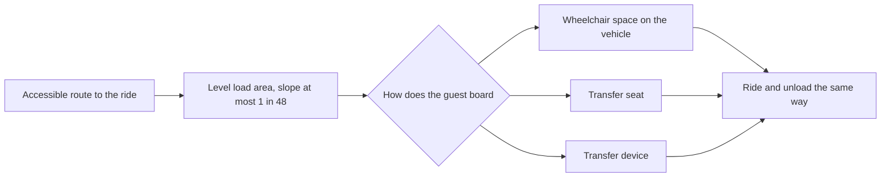

Accessibility has two layers. The first is law. In the United States the 2010 ADA Standards for Accessible Design include sections 234 and 1002 on amusement rides, and the Access Board's guide explains them in plain terms: each new ride must offer a wheelchair space, a transfer seat or a transfer device; the load area must be level, with a slope no steeper than 1:48; and clear floor and turning space are required where guests board. Travelling carnival rides and rider-operated rides such as bumper cars are exempt from the vehicle rules.

The second layer is **universal design**: the idea that a space built for the widest range of people from the start needs fewer special exceptions. A level [load area](../operations-business/load-unload-design.md) serves wheelchair users, strollers and anyone with stiff knees. A [queue](../human-factors/switchback-design.md) wide enough for a chair is also easier for families. Universal design also has to cover [evacuation](../safety-standards/emergency-stop-and-evacuation.md), where a guest who could board with help must also be able to leave a stopped ride.

Operators publish what each attraction offers; Walt Disney World's accessibility pages are one model. Rules vary by country within the wider [regulatory landscape](../safety-standards/regulatory-landscape.md), so international projects usually design to the strictest.

## Explore further
- `ada-2010-standards` — 2010 ADA Standards for Accessible Design
- `access-board-guide-amusement-rides` — Guide to the ADA Standards, Chapter 10: Amusement Rides
- `disney-accessibility-services` — Accessibility Services for Guests with Disabilities (Walt Disney World)
