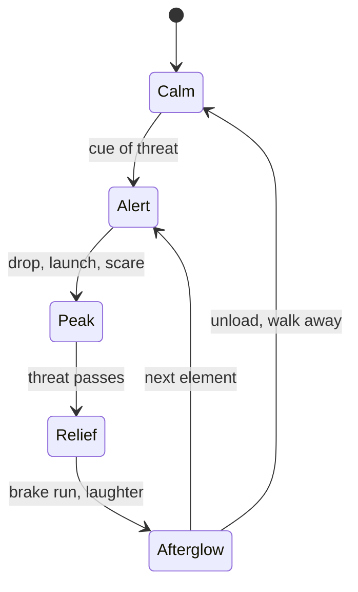

Arousal is the body's readiness setting: heart rate, breathing, adrenaline, muscle tone. It climbs when a threat appears and does not drop the instant the threat is gone. Instead there is a swing into relief, often felt as giddiness or laughter, that can feel better than the thrill itself. Reversal theory calls the ride through fear into relief a "parapathic" pleasure: fear enjoyed from inside a safe frame.

Rides are arousal shapes. A coaster's profile alternates spikes with breathing room, and the [brake run](../ride-engineering/brake-types.md) is where relief lands. Because arousal lingers for a minute or more, it can be handed from one element to the next, the idea behind [excitation transfer](../human-factors/excitation-transfer.md). There is also a sweet spot: too little arousal bores, too much overwhelms, which is the subject of [optimal arousal](../human-factors/optimal-arousal.md).

For designers, the relief half deserves as much care as the peak. The [finale](../story-experience/finale-design.md) and the [unload](../operations-business/load-unload-design.md) are where guests decide how the whole thing felt, and the [peak-end rule](../human-factors/peak-end-rule.md) says that judgement sticks.

## Explore further
- `apter-dangerous-edge-1992` — The Dangerous Edge: The Psychology of Excitement
- `zillmann-1971-excitation-transfer` — Excitation Transfer in Communication-Mediated Aggressive Behavior
