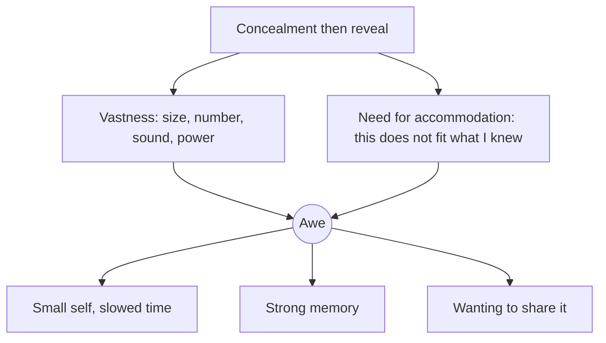

Dacher Keltner and Jonathan Haidt defined awe by two ingredients. First, *vastness*: something much bigger than you in size, number, loudness or power. Second, *need for accommodation*: the thing does not fit your existing mental model, so you have to update it. Beauty alone is not awe; a castle is awe when it is larger and stranger than any castle you had imagined.

Parks engineer both ingredients. A [central icon](../masterplanning/central-icon.md) gives vastness from the gate. A tight, dark corridor that opens onto a huge lit space supplies [reveal after concealment](../story-experience/reveal-and-concealment.md), the quickest way to force accommodation. Pandora's floating mountains and the banshee flight of Avatar Flight of Passage are built on the recipe: a scale the eye cannot settle, plus a physics the brain cannot explain.

Awe is worth the money because of what it does afterwards. People who feel small in front of something grand report slowed time, generosity and a strong urge to tell others, which is exactly the behaviour a park wants on the way out. See [scale and intimacy](../story-experience/scale-and-intimacy.md) for the design counterweight.

## Explore further
- `keltner-haidt-2003-awe` — Approaching Awe, a Moral, Spiritual, and Aesthetic Emotion
