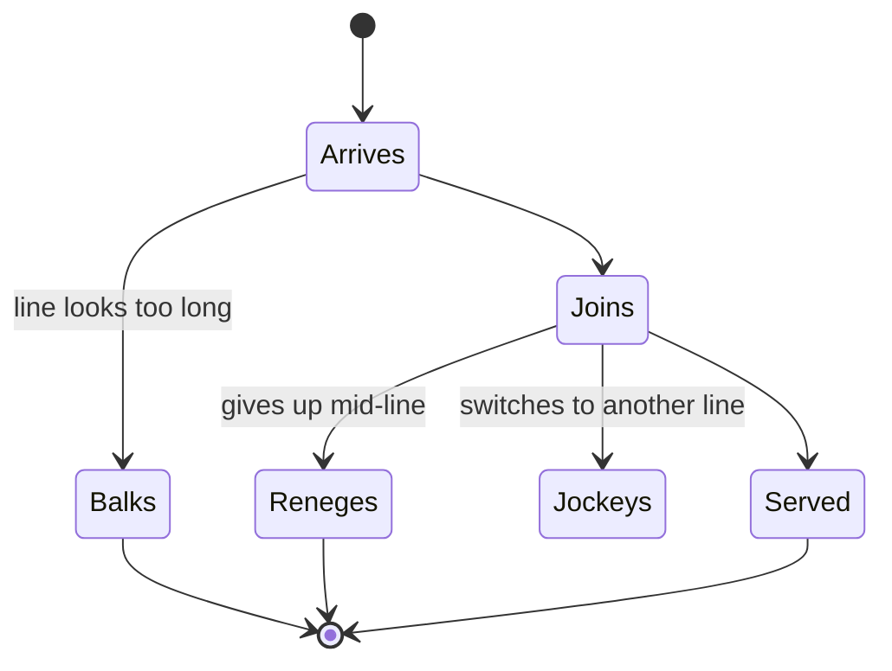

Queueing theory gives three names to the ways people abandon a line. *Balking* is refusing to join because the line looks too long. *Reneging* is joining and then leaving before being served. *Jockeying* is switching to another line that seems faster. All three are decisions made on perception, not the true wait, which makes them a design problem as well as a capacity one.

Parks manage each. Balking is driven by the posted time and by what the entrance shows: a visible sea of switchbacks balks guests who would have accepted the same wait hidden around a corner. Reneging is driven by progress cues, so Space Mountain's queue, as the Mental Floss overview describes, hides the remaining path behind walls, and guests who cannot see how far is left tend to stay. Larson's fairness work explains jockeying: a parallel-line layout invites it, a single serpentine line removes the option.

Every balk at a popular ride is a guest who raises some *other* line, which [capacity versus demand](../operations-business/capacity-vs-demand.md) models and [crowd analytics](../operations-business/crowd-analytics.md) try to anticipate. A ride known for balking also gets its [wait-time estimates](../operations-business/wait-time-estimation.md) wrong, because the people who left were never counted.

## Explore further
- `wikipedia-queueing-theory` — Queueing theory
- `mentalfloss-disney-queue-psychology` — The Psychological Tricks Disney Parks Use to Make Long Wait Times More Bearable
- `larson-1987-queue-social-justice` — Perspectives on Queues: Social Justice and the Psychology of Queueing
