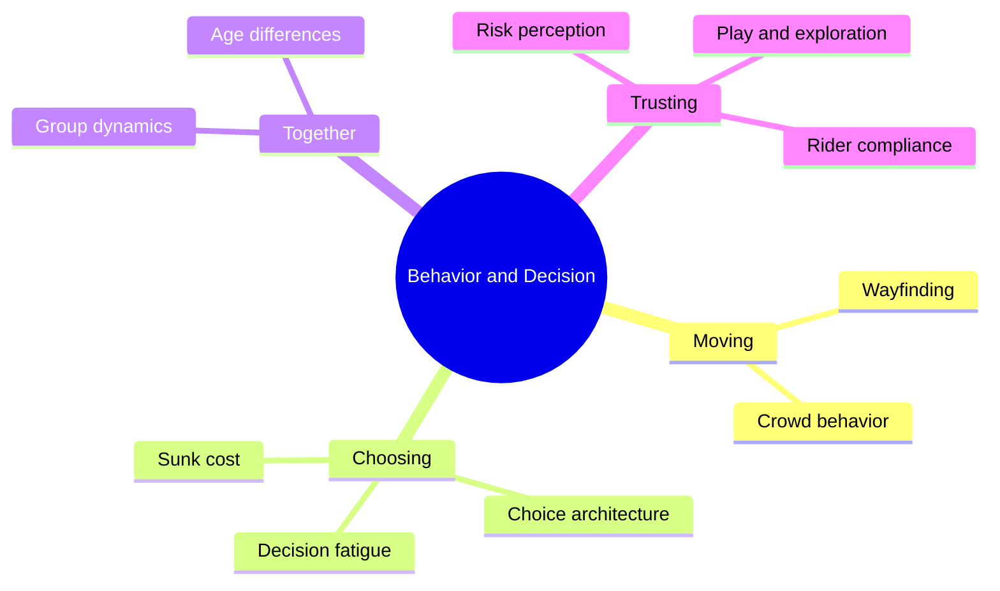

A park is a decision machine. Every guest makes hundreds of small choices a day: which way to turn, which line to join, whether to leave, whether to obey a sign. This super-concept collects the psychology behind those choices and the design levers that steer them.

Three strands run through it. **Movement**: people navigate by [landmarks and paths](../human-factors/landmarks-and-nodes.md), drift with the crowd, and carve [desire lines](../human-factors/desire-lines.md) where the plan was wrong. **Choice**: defaults, menus and apps form a [choice architecture](../human-factors/choice-architecture.md) that quietly decides for tired brains. **Trust and groups**: families plan around their least able member, weigh how risky a ride feels, and mostly follow the rules when the rules are clear.

The payoff is practical. Good wayfinding shortens [perceived waits](../human-factors/perceived-vs-actual-wait.md), nudges smooth [guest flow](../masterplanning/guest-flow-patterns.md), and understanding compliance makes [operator training](../safety-standards/operator-training.md) more realistic. Start with wayfinding, then crowd behavior, then the decision cards.

## Explore further
- `lynch-image-of-the-city` — The Image of the City (book)
- `thaler-sunstein-nudge` — Nudge (book)
- `helbing-social-force-1995` — Social force model for pedestrian dynamics
