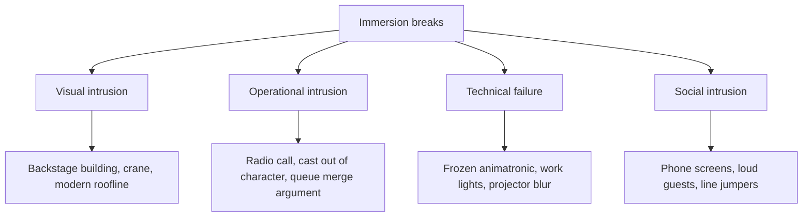

Immersion rarely fades; it snaps. Sorting the breaks by cause helps, because each has a different owner. **Visual intrusion** is the masterplanner's and architect's problem: a hotel tower over a medieval wall, a crane in the sightline, an unpainted service door. **Operational intrusion** is the operations team's: a radio squawk, a cast member chatting about their shift, a sudden stop with no story explanation. **Technical failure** belongs to show maintenance: a frozen figure in a lit scene is worse than an empty scene. **Social intrusion** comes from other guests.

Presence research explains why small breaks matter so much. Slater's plausibility illusion depends on the world behaving consistently; a single inconsistency is evidence that none of it is real, and the guest's brain updates fast. Lynch's point about edges applies too: the [berm](../story-experience/the-berm.md) and [sightline](../story-experience/sightlines.md) control exist to stop the real world appearing as an edge inside the fictional one.

The two child cards go deeper: [visual intrusion](../human-factors/visual-intrusion.md) and [operational intrusion](../human-factors/operational-intrusion.md). The cure for most of the rest is the discipline of [onstage and backstage](../masterplanning/onstage-backstage.md) planning and the paint colour known as [go-away green](../sensory-environment/go-away-green.md).

## Explore further
- `slater-place-illusion-plausibility-2009` — Place illusion and plausibility can lead to realistic behaviour in immersive virtual environments
- `lynch-image-of-the-city` — The Image of the City (book)
