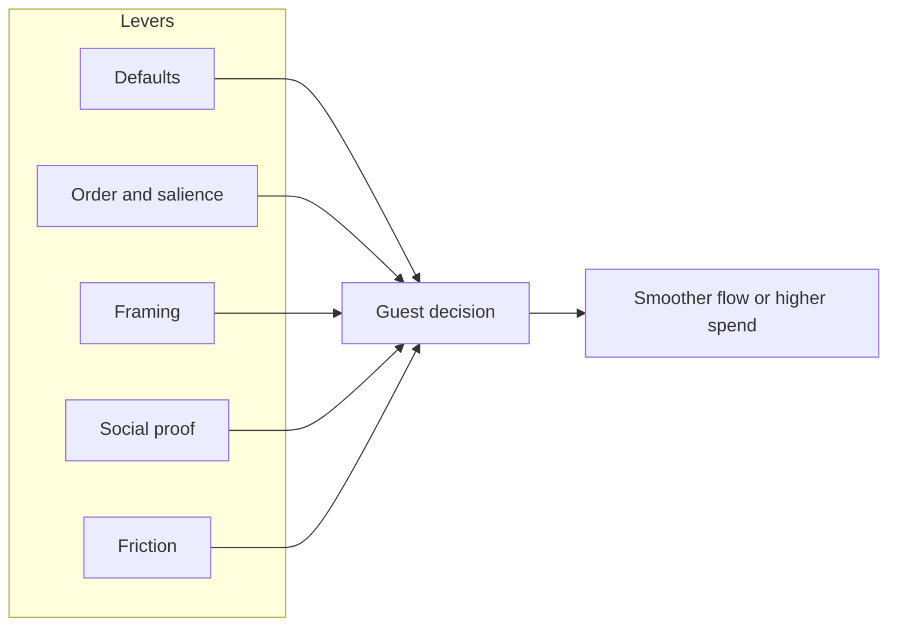

Richard Thaler and Cass Sunstein coined **choice architecture** for the simple fact that someone always decides how options are laid out, and that layout changes what people pick. A **nudge** is a design that steers people while leaving every option open: a default, an order, a label, a little friction.

Parks are full of them. A [virtual queue](../human-factors/virtual-queues.md) that opens at 7 a.m. nudges guests toward early arrival. The app that shows a short wait first sends a crowd there. Menus list the combo before the single item. [Paid priority access](../human-factors/paid-priority-access.md) is framed as "skip the line" rather than "pay to pass others", because the frame changes how fair it feels. [Retail placement](../masterplanning/food-and-retail-placement.md) at ride exits is a nudge with a cash register.

The ethical line is whether the nudge serves the guest or only the operator. Nudging families toward a quieter land improves everyone's day; a default that quietly adds a photo package does not. Because many nudges now run through apps that track location and spend, choice architecture also runs into [data privacy](../ai-future/data-privacy.md) questions. The test Thaler and Sunstein proposed still works: would you be comfortable explaining the nudge to the person being nudged?

## Explore further
- `thaler-sunstein-nudge` — Nudge (book)
- `cialdini-influence` — Influence: The Psychology of Persuasion (book)
