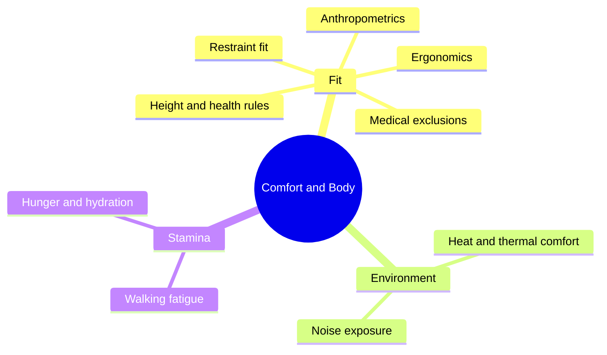

Before a guest can be thrilled or moved, their body has to be comfortable enough to pay attention. This super-concept covers the physical side of human factors: how big people are, how they fit into seats and restraints, how heat, noise and walking wear them down, and which health conditions a ride must warn about.

Two threads tie the cards together. The first is **fit**. [Ergonomics](../human-factors/ergonomics.md) is the discipline; [anthropometrics](../human-factors/anthropometrics.md) is the data, from surveys such as ANSUR II and CAESAR; [restraint fit](../human-factors/restraint-fit.md) and [height rules](../human-factors/height-and-health-requirements.md) are where the data meets the standards, especially the patron containment clauses of ASTM F2291. The second is **stamina**. Parks are hot, loud, long walks between queues, and the design of [shade](../sensory-environment/shade-and-microclimate.md), [rest areas](../masterplanning/rest-areas.md) and food stops decides whether the afternoon is pleasant or a slog.

The engineering land handles the forces on the body; this land handles the body itself. Read ergonomics first, then anthropometrics, then whichever comfort topic your project is failing at.

## Explore further
- `iea-what-is-ergonomics` — What is Ergonomics (HFE)? International Ergonomics Association
- `ansur-ii-open-design-lab` — ANSUR II anthropometric dataset
- `astm-f2291-design-standard` — ASTM F2291 Standard Practice for Design of Amusement Rides and Devices
