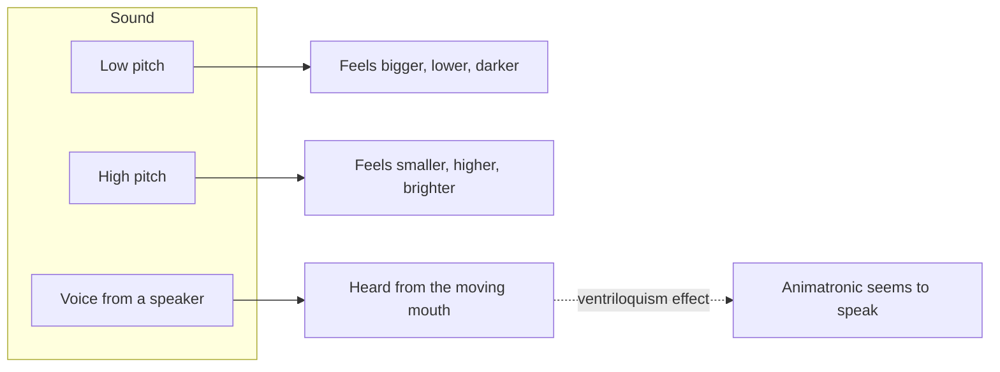

Charles Spence's tutorial review catalogues *crossmodal correspondences*: reliable, mostly unconscious pairings between features of different senses. High pitch goes with small, bright, sharp and high-up; low pitch with large, dark, round and low-down. Sweet tastes pair with round shapes and pink, bitter with angular shapes and black. These links hold across cultures and appear early in childhood.

Alongside correspondences sit *crossmodal illusions*, where one sense captures another. In the ventriloquism effect, a sound is heard at the place where a plausible moving source is seen; this is why an animatronic's voice, played from a hidden speaker, seems to come from its lips as long as [figure programming](../show-technology/figure-programming.md) keeps the jaw in sync. In the reverse direction, a well-timed low-frequency rumble makes a modest drop feel bigger, and a rising whine makes a launch feel faster.

For designers the catalogue is a toolkit. [Spatial audio](../show-technology/onboard-and-spatial-audio.md) places sources where the eye expects them; the [sound design pipeline](../show-technology/sound-design-pipeline.md) tunes pitch to scale; [colour](../sensory-environment/color-psychology.md) and [lighting](../sensory-environment/lighting-mood.md) can make a room feel warmer, heavier or sweeter before anything happens in it.

## Explore further
- `spence-2011-crossmodal-correspondences` — Crossmodal Correspondences: A Tutorial Review
