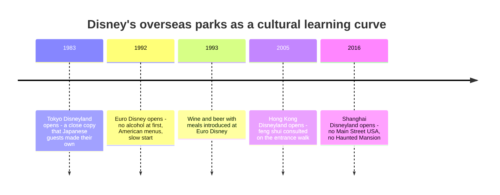

Disney's overseas parks tell this lesson in sequence. **Tokyo Disneyland** (1983) was built as a faithful copy, and the anthropologist Aviad Raz showed how Japanese guests and staff reinterpreted it on their own terms, from gift-giving souvenir habits to orderly queue culture. **Euro Disney** (1992) opened with largely American menus and no alcohol in the park; attendance badly missed forecasts, and wine and beer with meals arrived in 1993. **Hong Kong Disneyland** (2005) consulted feng shui advisers, which is why the walkway near the entrance has a bend to keep good energy from flowing out to sea; the widely repeated claim that the main gate was rotated twelve degrees is unverified here beyond travel press. **Shanghai Disneyland** (2016) went furthest: Mickey Avenue instead of Main Street, no Haunted Mansion out of respect for ancestor veneration, and a Chinese zodiac garden.

For designers the differences show up everywhere: how close strangers stand in a queue (see [personal space](../human-factors/personal-space-and-density.md)), whether guests eat at tables or walking, how much they spend on gifts for others, which [IP](../story-experience/ip-adaptation.md) means anything, and which stories offend. The [localisation](../human-factors/localisation.md) card covers the craft of adapting; the history land's [global parks](../history/disney-global-parks.md) card gives the business story.

## Explore further
- `raz-riding-the-black-ship` — Riding the Black Ship: Japan and Tokyo Disneyland (book)
- `wikipedia-disneyland-paris` — Disneyland Paris
- `wikipedia-hong-kong-disneyland` — Hong Kong Disneyland
- `cheung-mccarthy-shanghai-disneyland-2019` — The emotional branding of Disneyland in Shanghai
