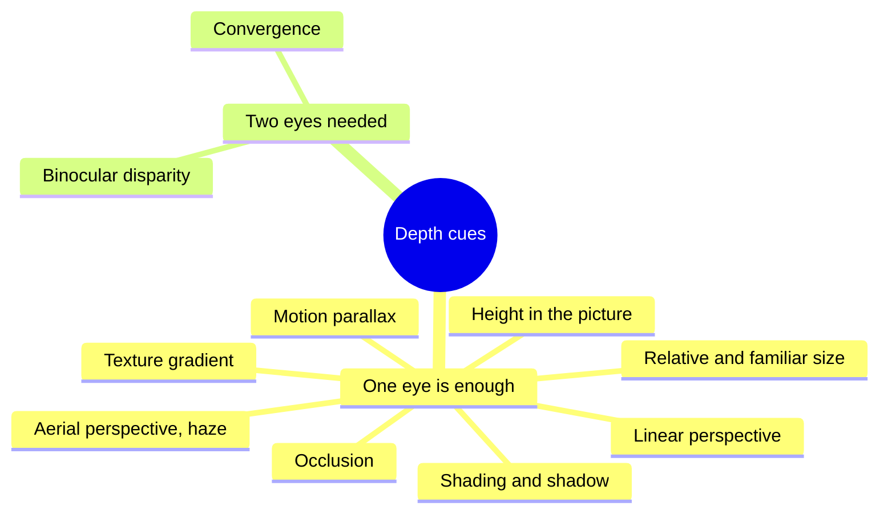

Vision science lists more than a dozen cues the brain uses to recover depth from a flat image. Most need only one eye: a nearer object hides a farther one (occlusion), parallel lines converge, textures get finer with distance, distant hills go bluer and paler (aerial perspective), and when you move, near things slide past faster than far things (motion parallax). Two more need both eyes: the small difference between the two retinal images (binocular disparity, the basis of stereopsis) and the angle the eyes turn inward to fuse a target (convergence).

Each craft in a park picks its cues. [Scenic painters](../design-process/scenic-painting.md) can only use the one-eyed set, so a painted backdrop leans on haze, overlapping flats and perspective. Dark rides add motion parallax by layering real set pieces in front of the painting; the layers and [kinetic elements](../story-experience/kinetics-in-scenes.md) slide past at different rates as the vehicle moves. [Stereoscopic 3D](../show-technology/stereoscopic-3d.md) supplies disparity directly, which is why it can throw an object into the rider's lap, but it collides with convergence and focus cues and tires some viewers. [Projection mapping](../show-technology/projection-mapping.md) paints shading and occlusion onto real geometry.

Every cue assumes a viewpoint, so [sightline](../story-experience/sightlines.md) planning decides which tricks survive.

## Explore further
- `wikipedia-depth-perception` — Depth perception
