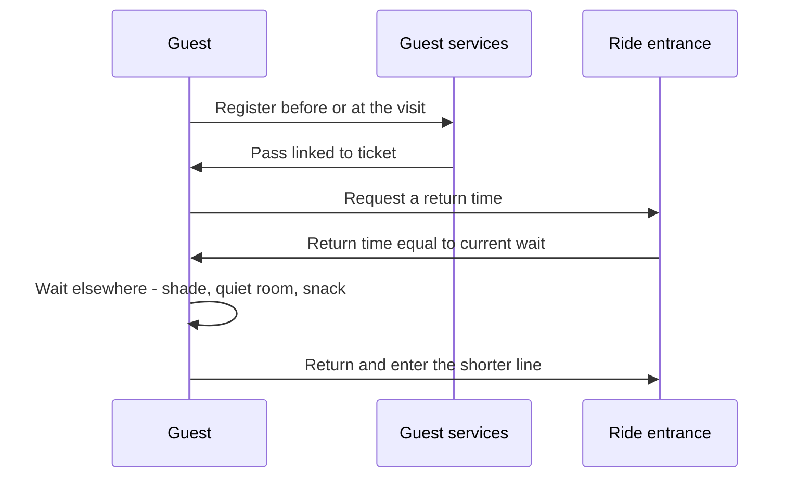

A disability access service is a queue alternative for guests whose condition makes a long, enclosed, standing wait impossible, even though they can ride. Instead of standing in line, the guest gets a return time roughly equal to the current posted wait and comes back then, entering through a shorter line. Walt Disney World's version is Disability Access Service (DAS), registered through guest services and linked to the party's tickets; Universal Orlando offers a comparable attraction assistance pass described in its rider guide.

The design logic is fairness. The guest does not wait less; they wait differently, in the [rest area](../masterplanning/rest-areas.md) or quiet room where the wait is bearable. That keeps the scheme distinct from [paid priority access](../human-factors/paid-priority-access.md) and protects [queue fairness](../human-factors/queue-fairness.md) for everyone else. The mechanics increasingly run on the same app and [wearable](../operations-business/wearables-and-identity.md) systems as [virtual queues](../human-factors/virtual-queues.md).

The hard part is eligibility. Operators have tightened registration in recent years in response to misuse, and the rules change often, so the exact criteria at any park are uncertain without checking its current page. What does not change is that the cast member at the entrance is the service, and [service culture](../operations-business/service-culture.md) decides whether the guest feels accommodated or interrogated.

## Explore further
- `disney-disability-access-service` — Disability Access Service (Walt Disney World)
- `disney-accessibility-services` — Accessibility Services for Guests with Disabilities (Walt Disney World)
- `universal-orlando-rider-guide` — Universal Orlando Guide for Rider Safety and Accessibility (PDF)
