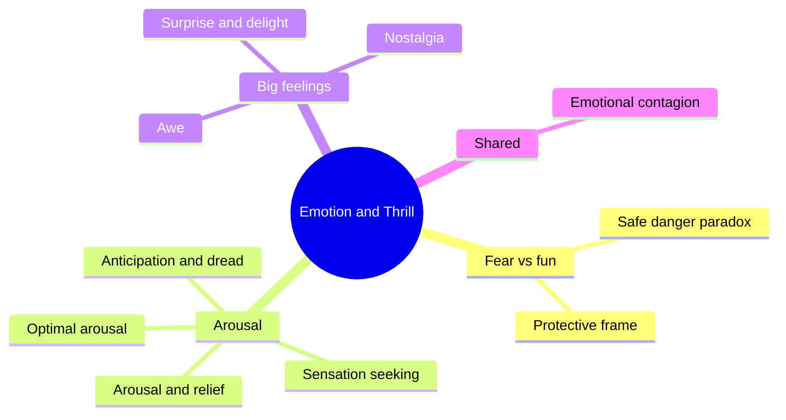

A ride does not deliver emotion directly. It delivers physical events, such as a drop, a launch, darkness or a sudden face, and the rider's body responds with arousal: faster heart, adrenaline, tensed muscles. What that arousal *means* is decided by context. The same racing pulse is terror on a broken ride and joy on a trusted one. This super-concept collects the ideas that explain that translation.

Start with [fear vs fun](../human-factors/fear-vs-fun.md) and the protective frame, which explain why paying to be scared makes sense. Then look at how arousal builds and drains across a ride, through [anticipation](../human-factors/anticipation-and-dread.md), relief and leftover excitement. [Awe](../human-factors/awe.md) and [nostalgia](../human-factors/nostalgia.md) are the quieter emotions that parks sell just as hard. Finally, emotions spread between riders, which is why a full train screams louder than a half-empty one.

For designers, the payoff is in the story land: these curves are what a [ride beat sheet](../story-experience/ride-beat-sheet.md) and [tension and release](../story-experience/tension-and-release.md) are really shaping, within the limits set by [g-force tolerance](../ride-engineering/g-tolerance-and-duration.md).

## Explore further
- `apter-dangerous-edge-1992` — The Dangerous Edge: The Psychology of Excitement
- `zillmann-1971-excitation-transfer` — Excitation Transfer in Communication-Mediated Aggressive Behavior
- `keltner-haidt-2003-awe` — Approaching Awe, a Moral, Spiritual, and Aesthetic Emotion
