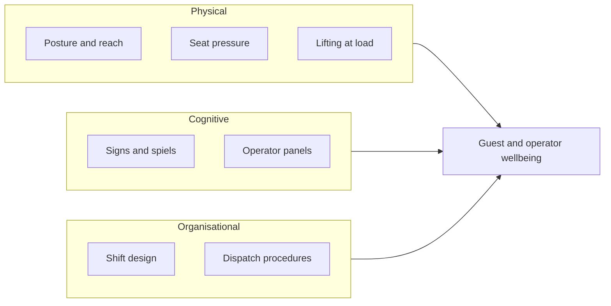

Ergonomics, or human factors engineering, is the discipline of fitting systems to people. The International Ergonomics Association defines it as the study of interactions between humans and the other parts of a system, and splits it into three domains: **physical** (posture, force, body size), **cognitive** (perception, memory, workload) and **organisational** (teams, shifts, procedures).

In a park all three apply at once. A coaster [seat](../ride-engineering/seat-and-containment.md) is a physical ergonomics problem: a seat pan and back angle that hold the body through strong forces without bruising, for a wide range of sizes drawn from datasets such as ANSUR II. The [rider's position](../ride-engineering/rider-position.md) decides what the neck must do in a corner. The operator's control panel is a cognitive problem: the emergency stop must be findable without looking. Staffing and [dispatch](../operations-business/ride-operations-staffing.md) rotations are organisational problems; a bored operator in the eighth hour misses more.

Ergonomics is cheapest early. Parks and manufacturers build full-scale [mockups](../design-process/mockups-and-prototypes.md) of vehicles and stations and put real bodies in them, from a small child to a tall adult, before tooling is cut. Good [load and unload design](../operations-business/load-unload-design.md) comes from watching those bodies climb in and out hundreds of times.

## Explore further
- `iea-what-is-ergonomics` — What is Ergonomics (HFE)? International Ergonomics Association
- `ansur-ii-open-design-lab` — ANSUR II anthropometric dataset
