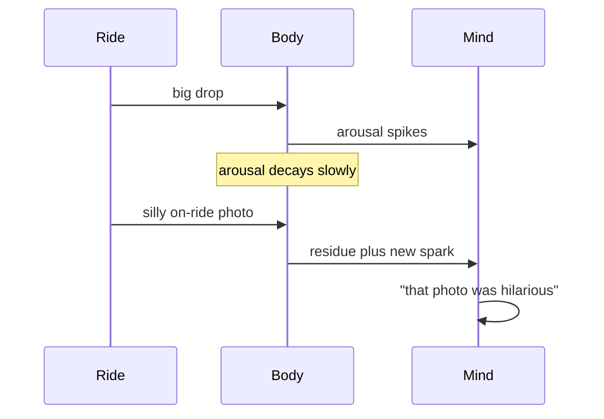

Dolf Zillmann showed that people who had just exercised, and whose bodies were still buzzing, reacted more strongly to a later provocation than people who had rested. They did not feel "still worked up from the bike"; they felt *more annoyed*. The body's arousal outlasts the mind's label for it, so the next thing that happens inherits the charge. He called this excitation transfer.

Rides leak arousal everywhere, and good designers catch it. The [on-ride photo](../human-factors/photo-moments.md) screen at unload is funnier than it would be cold. A [finale](../story-experience/finale-design.md) joke or a cast member's quip lands harder. A gift shop placed right at the exit, the classic [exit-through-retail](../masterplanning/food-and-retail-placement.md) move, meets guests at their most excitable. Even the [unload](../operations-business/load-unload-design.md) sequence matters: a calm, friendly station lets residual arousal settle into warmth rather than irritation.

The same mechanism cuts the other way. Residual stress from a hot, confusing queue can be transferred onto the ride and read as "the ride was annoying".

## Explore further
- `zillmann-1971-excitation-transfer` — Excitation Transfer in Communication-Mediated Aggressive Behavior
