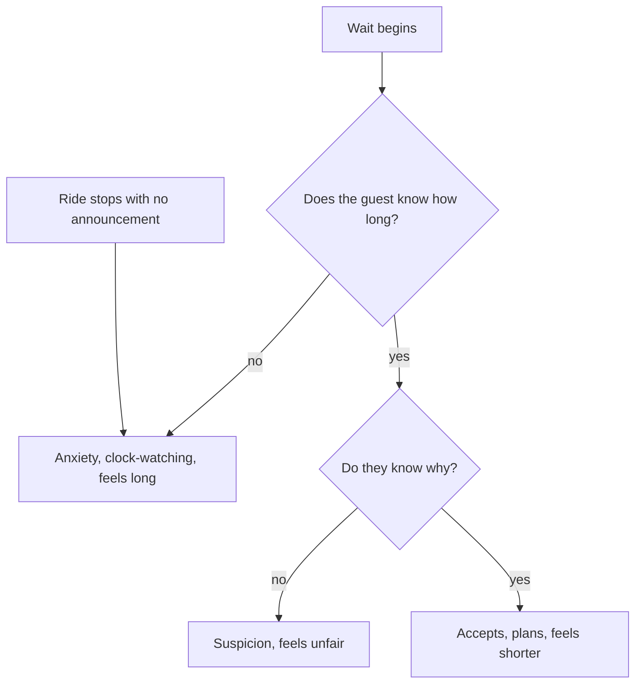

Two of Maister's propositions are about information. Uncertain waits feel longer than known, finite waits; unexplained waits feel longer than explained ones. A posted time turns an open-ended wait into a countdown; a reason turns a grievance into a plan.

Hui and Tse tested which message to give. In their experiments the best choice depended on the wait's length: for longer waits, queue position worked better; for medium waits, a duration estimate; for short waits, information added little. Match the message to the situation rather than defaulting to one sign.

The acid test is downtime. When a ride stops mid-queue with silence from the operators, the clock stretches and the rumour mill starts; a prompt, specific announcement from a trained [operator](../safety-standards/operator-training.md) reframes the pause and is the first step of [guest recovery](../operations-business/guest-recovery.md). The same principle applies inside a stopped vehicle during an [e-stop](../safety-standards/emergency-stop-and-evacuation.md), where a calm voice explaining the next step is a safety measure as much as a courtesy. [Live wait data in apps](../operations-business/wait-time-data-and-apps.md) extends explanation to guests not yet in line, and a [service culture](../operations-business/service-culture.md) that lets staff explain makes the policy real.

## Explore further
- `maister-psychology-of-waiting-lines` — The Psychology of Waiting Lines
- `hui-tse-1996-waits-of-different-lengths` — What to Tell Consumers in Waits of Different Lengths
