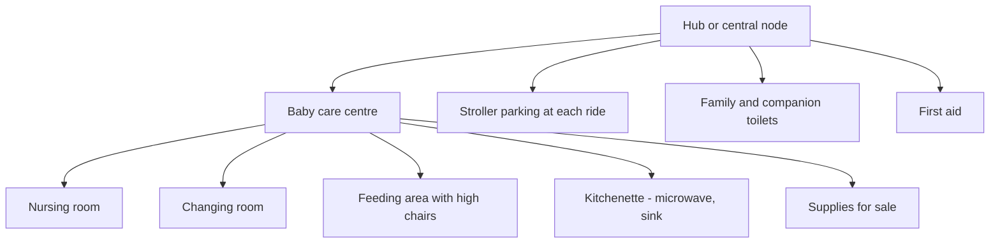

A family with an infant plans the day around feeds, naps and nappies. If the park cannot support those, the family leaves early, so the business case is simply [length of stay](../operations-business/length-of-stay.md). Walt Disney World's baby care centres are a useful benchmark. Each of its four parks has one, free to use, with a nursing room, a changing room, a feeding area with high chairs, a kitchenette with microwave and sink, and a small shop for formula, food, nappies and medicine. They sit near the centre of the park, not at the gate.

The wider checklist is longer. Shaded stroller parking at every attraction keeps strollers out of queues. Companion toilets let a parent take an opposite-sex child or a carer help an adult. First aid should be easy to find and near the [hub](../masterplanning/hub-and-spoke.md). Shaded [rest areas](../masterplanning/rest-areas.md) matter for toddlers. [Rider switch](../human-factors/rider-switch.md) is the facility for the ride itself.

Much of this is plumbing and services, part of [utilities planning](../masterplanning/utilities-and-central-plant.md), which is why it is cheap to include early and expensive to retrofit. The rest is [service culture](../operations-business/service-culture.md): a cast member who warms a bottle without being asked is worth more than any sign.

## Explore further
- `disney-baby-care-centers` — Baby Care Centers (Walt Disney World)
- `disney-rider-switch` — What Is Rider Switch and How Does It Work?
