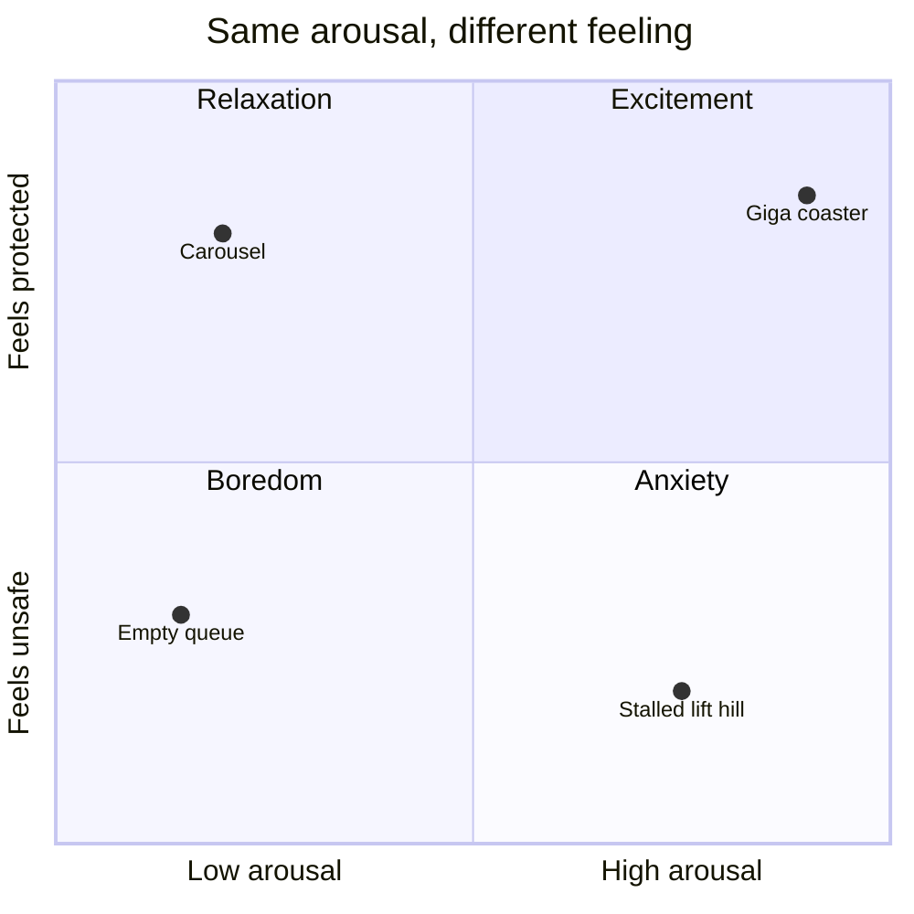

Michael Apter's reversal theory makes a simple claim: high arousal is not good or bad in itself. In an anxious, goal-focused state (he calls it *telic*) arousal feels like fear. In a playful state (*paratelic*) the very same arousal feels like excitement. People flip between these states, often in seconds, which is why a rider can scream in terror on the drop and laugh at the brake run.

What flips the switch is a [protective frame](../human-factors/protective-frame.md): a felt sense that nothing can really go wrong. Restraints that click reassuringly, visible [maintenance](../safety-standards/inspections.md) and the sight of other riders returning smiling all build it. Anything that cracks the frame, from a [rough ride](../ride-engineering/rough-rides.md) to a confusing [restraint fit](../human-factors/restraint-fit.md), turns fun back into fear. Designers should treat [trust](../human-factors/risk-perception-and-trust.md) as the ingredient that makes intensity sellable.

## Explore further
- `apter-dangerous-edge-1992` — The Dangerous Edge: The Psychology of Excitement
- `andrade-cohen-2007-negative-feelings` — On the Consumption of Negative Feelings
