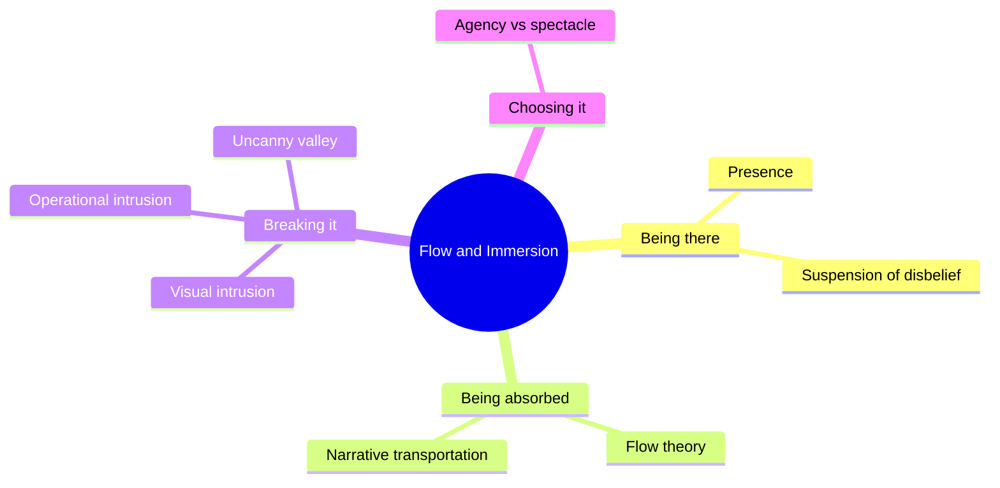

Immersion is the word the industry uses for a bundle of distinct mental states. This super-concept pulls them apart so designers can aim at the right one. **Presence** is the sense of being in a place, which Mel Slater splits into place illusion and plausibility. **Suspension of disbelief** is the audience's half of the bargain. **Flow** is Csikszentmihalyi's absorbed state when challenge matches skill. **Narrative transportation**, from Green and Brock, is being lost in a story.

Each has its own enemies. A glimpse of a service road, a radio call during a scene, or an almost-human face that falls into the [uncanny valley](../human-factors/uncanny-valley.md) can collapse presence in a second; the [breaking immersion](../human-factors/breaking-immersion.md) cards catalogue them. There is also a live design argument, covered in [agency vs spectacle](../human-factors/agency-vs-spectacle.md), about whether letting guests act deepens immersion or cuts it.

The practical thread is that immersion is built from thousands of small decisions in [themed storytelling](../story-experience/themed-storytelling.md), [onstage and backstage](../masterplanning/onstage-backstage.md) planning and [animatronic](../show-technology/animatronics.md) craft, and lost by any one of them.

## Explore further
- `slater-place-illusion-plausibility-2009` — Place illusion and plausibility can lead to realistic behaviour in immersive virtual environments
- `csikszentmihalyi-flow` — Flow: The Psychology of Optimal Experience (book)
- `green-brock-narrative-transportation-2000` — The role of transportation in the persuasiveness of public narratives
