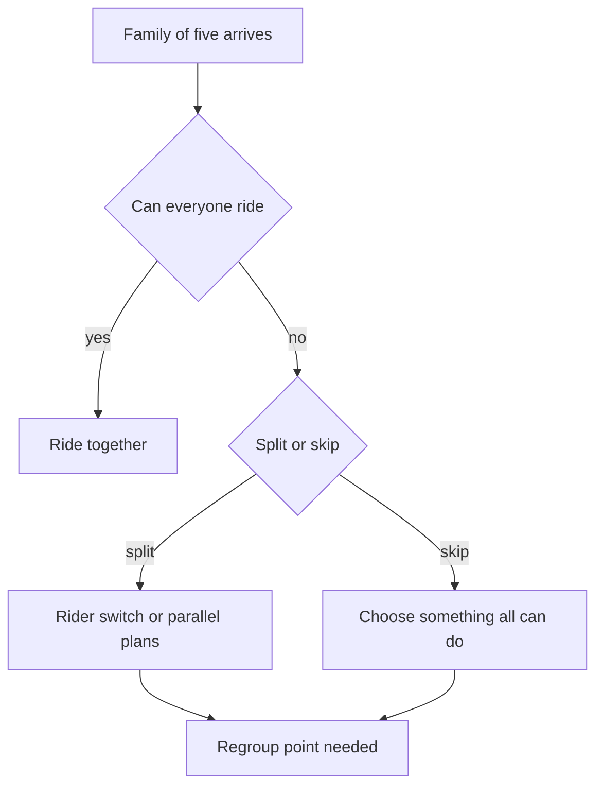

Almost nobody visits a theme park alone. Guests arrive as couples, families, school groups and friend groups, and the group, not the individual, makes the decisions. A park designed for an imagined average rider will frustrate the group that actually turns up: a grandparent, two parents, a teenager who wants the tallest coaster and a four-year-old who cannot ride it.

Groups behave in recognisable ways. They move at the pace of the slowest member. They need to regroup after any split, so [rest areas](../masterplanning/rest-areas.md) and benches near big-ride exits do real work. They negotiate, and the negotiation is tiring, which feeds [decision fatigue](../human-factors/decision-fatigue.md). They also want shared memories, which is why an [attraction mix](../masterplanning/attraction-mix.md) with plenty of all-ages rides, including [family coasters](../ride-systems/family-coasters.md), tends to outperform a pure thrill lineup.

Two tools for groups have their own cards. [Rider switch](../human-factors/rider-switch.md) lets adults take turns without queuing twice. [Lowest common denominator planning](../human-factors/lowest-common-denominator.md) is the designer's response: plan the day, and the park, around the member with the tightest limits. Operators study all of this through [guest research](../operations-business/guest-research.md), and height-by-age data such as the CDC growth charts tells them exactly how many children a given height rule splits from their family.

## Explore further
- `disney-rider-switch` — What Is Rider Switch and How Does It Work?
- `cdc-growth-charts` — CDC Growth Charts
