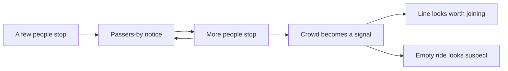

In 1969 Stanley Milgram and colleagues had a few people stand on a New York sidewalk and stare up at a sixth-floor window. One person drew a few glances; a group of fifteen made most passers-by stop and look up too. That is **social proof**: when we are unsure, we read other people's behaviour as information. Robert Cialdini later made it one of his core principles of influence.

In a park, the crowd is the loudest sign. A long visible line suggests a great ride and recruits more riders; an empty queue suggests something is wrong, even when the ride has just reopened. Herding also shapes dining and show choice, which is why the [attraction mix](../masterplanning/attraction-mix.md) and [entertainment schedule](../operations-business/entertainment-scheduling.md) are tuned to spread crowds rather than let one hot spot feed on itself.

Herding has a dark side. Helbing's panic simulations show how people in an emergency follow whoever is moving, which can pile a crowd against one exit while another sits unused. Designers counter this with evenly lit, clearly marked exits, and operators counter it with [posted wait times](../operations-business/wait-time-data-and-apps.md) that give people better information than the crowd itself, reducing needless [balking](../human-factors/balking-and-reneging.md).

## Explore further
- `milgram-drawing-power-of-crowds-1969` — Note on the drawing power of crowds of different size
- `cialdini-influence` — Influence: The Psychology of Persuasion (book)
- `helbing-escape-panic-2000` — Simulating dynamical features of escape panic
