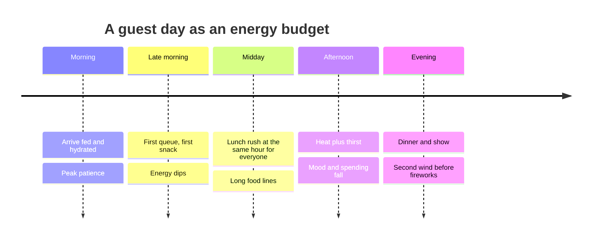

Hunger and thirst are physiology, but in a park they are also a scheduling problem. Everyone gets hungry at roughly the same time, so a restaurant line at 12:30 can be longer than a coaster's. Dehydration creeps up quietly, especially in heat; NIOSH lists not drinking enough fluids as a heat-illness risk factor, and children often do not ask for water until they are already irritable.

Design answers start with placement. [Food and retail placement](../masterplanning/food-and-retail-placement.md) puts quick-service counters where guests naturally pause, near big-ride exits and show venues, and spreads them so no single land starves. Free water at counters and plentiful fountains reduce heat incidents and build goodwill. Shaded [rest areas](../masterplanning/rest-areas.md) with tables let families eat what they brought.

Operations shapes the timing. [Entertainment scheduling](../operations-business/entertainment-scheduling.md) can pull crowds into shows at noon and spread the meal rush, and mobile ordering lets a family order from the queue and collect on exit. There is a business reason too: food and drink are a large share of [per-capita spending](../operations-business/per-capita-spending.md), and a guest who leaves early because they felt awful never bought dinner.

## Explore further
- `niosh-heat-stress` — NIOSH: About Heat Stress
- `fruin-pedestrian-planning-1971` — Pedestrian Planning and Design (book)
