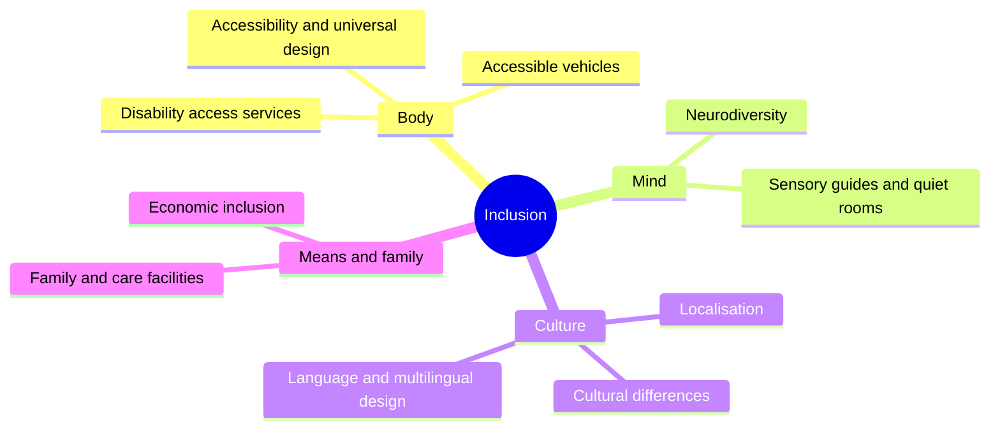

Inclusion asks a simple question of every design decision: who does this leave out? The answer is rarely nobody. A queue with stairs excludes wheelchair users; a strobe-lit pre-show excludes some autistic guests; an English-only spiel excludes most of the world; a price excludes a family; a ride seat excludes a body. This super-concept gathers the responses.

The cards split into four groups. **Body**: [accessibility](../human-factors/accessibility.md) covers the legal baseline of the ADA and the design idea of universal access, with [accessible vehicles](../human-factors/accessible-vehicles.md) and [access services](../human-factors/disability-access-services.md) as the practical tools. **Mind**: [neurodiversity](../human-factors/neurodiversity.md) and the sensory guides and quiet rooms that certified parks provide. **Culture**: how parks in Tokyo, Paris, Hong Kong and Shanghai changed Disney's formula, and how languages are handled. **Means**: pricing, charity programmes, and the baby-care and family facilities that decide whether a family can stay all day.

Inclusion is not a bolt-on. The same [load area](../operations-business/load-unload-design.md) that fits a transfer seat fits a tired grandparent, and the same [service culture](../operations-business/service-culture.md) that handles a wheelchair handles everything else.

## Explore further
- `ada-2010-standards` — 2010 ADA Standards for Accessible Design
- `ibcces-certified-autism-center` — Certified Autism Center program (IBCCES)
- `cheung-mccarthy-shanghai-disneyland-2019` — The emotional branding of Disneyland in Shanghai
