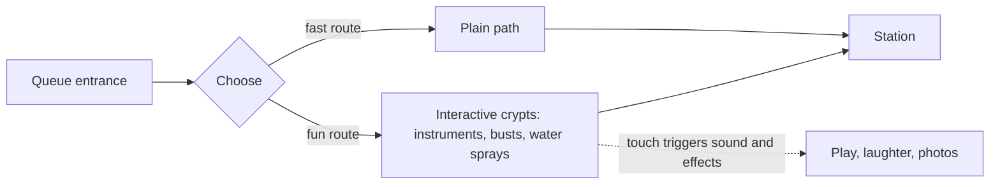

An interactive queue gives guests something to *do*, not just look at. The reference case is the Haunted Mansion at Walt Disney World's Magic Kingdom, whose expanded queue previewed in March 2011: a composer's crypt with instruments that sound when touched, busts that follow or react, a sea captain's tomb that sprays water, and tombstones carrying jokes for those who read them. Imagineers Eric Goodman and Pete Carsillo gave the first video tour of it to Disney Parks Blog readers.

The psychology is Maister's occupied time with a second ingredient, agency. Touching a thing and getting a response is more absorbing than watching, and it invites [play and exploration](../human-factors/play-and-exploration.md), especially for children, which keeps a family group together and in good humour. It also extends the story: the queue becomes the first room of the attraction rather than a holding pen, which is the aim of [queue storytelling](../story-experience/queue-storytelling.md).

Two design rules follow. First, interaction slows people down, so a bypass, the fast route the Haunted Mansion opened with, protects throughput and the guests who just want to ride. Second, hands-on props are [show action equipment](../show-technology/show-action-equipment.md) in all but name: they need the same durability, sensors and maintenance plan.

## Explore further
- `laughingplace-haunted-mansion-queue-2011` — Video: A Look at the Magic Kingdom's New Haunted Mansion Interactive Queue
- `maister-psychology-of-waiting-lines` — The Psychology of Waiting Lines
