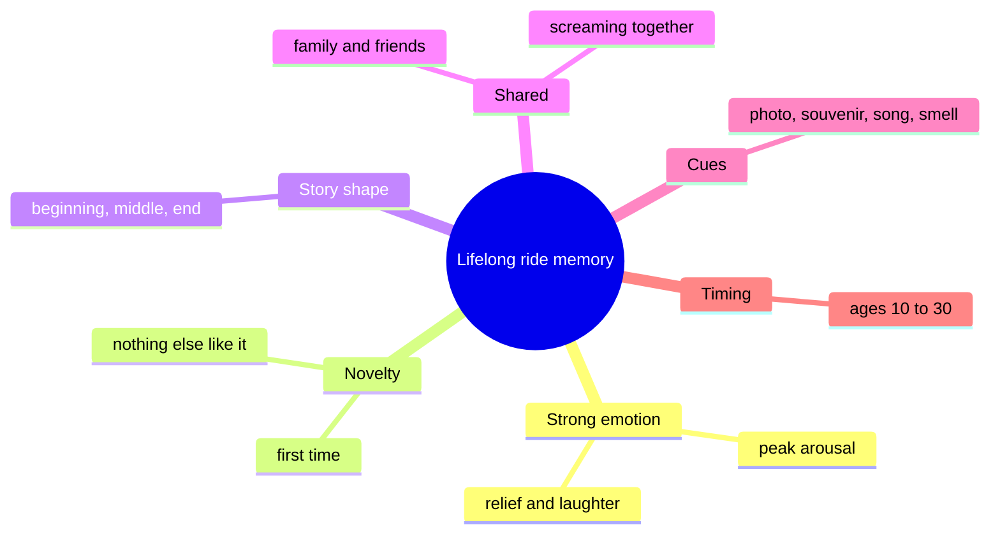

Ask almost anyone about a childhood park visit and a ride comes back in detail, decades later. No single effect explains that; rides happen to hit every lever memory research has found.

Emotion first. Intense arousal flags an event as worth keeping, and the [peak-end rule](../human-factors/peak-end-rule.md) means a ride with a big moment and a clean finish is encoded favourably. Novelty second: a first drop or a first flight is unlike anything in daily life, so it does not blur into routine. Story third: a ride with [narrative shape](../human-factors/narrative-memory.md) is easy to replay and retell, and retelling rehearses the memory. Company fourth: most rides are taken with people we love, and [shared screaming](../human-factors/emotional-contagion.md) binds the memory to them. Cues fifth: the [photo](../human-factors/photo-moments.md), the souvenir and the song keep pulling it back. Timing last: visits during the [reminiscence bump](../human-factors/reminiscence-bump.md) get a lifetime head start.

The business reading is that a park sells future memories, so [attendance models](../operations-business/roi-and-attendance-modeling.md) should weight the return visit a memory produces, not just today's gate.

## Explore further
- `kahneman-peak-end-1993` — When More Pain Is Preferred to Less: Adding a Better End
- `munawar-2018-reminiscence-bump` — Understanding the Reminiscence Bump: A Systematic Review
- `hatfield-1993-emotional-contagion` — Emotional Contagion
