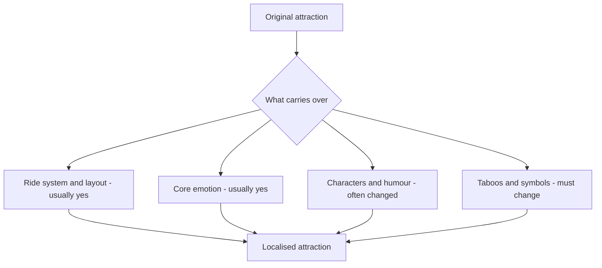

Localisation is translation at the level of meaning. The ride hardware travels fine; the story, jokes, symbols and premise may not. Cheung and McCarthy's analysis of its "authentically Disney, distinctly Chinese" positioning shows how the park removed American references that earlier overseas parks had kept, and Blooloop's opening coverage lists the concrete swaps: a character-themed Mickey Avenue instead of a small-town American Main Street, a Garden of the Twelve Friends built around the Chinese zodiac, and no Haunted Mansion.

Hong Kong Disneyland's [Mystic Manor](../history/mystic-manor.md) is the case designers most admire. Rather than import a ghost story that sits awkwardly with local attitudes to the dead, Imagineers kept the haunted-house ride form and made it an explorer's museum where artefacts come alive. Same ride genre, different meaning, no ghosts.

Localisation also runs the other way. Aviad Raz described how Tokyo Disneyland's guests and cast localised an almost unchanged American park through their own habits, from souvenir buying to queue discipline. Practical levers include [IP adaptation](../story-experience/ip-adaptation.md) choices, rewritten [show scripts](../story-experience/show-scripts.md), menu changes, and sometimes a full [retheme](../operations-business/retheming-and-overlays.md) of an imported ride. What should never change is the core emotional beat the ride was built to deliver.

## Explore further
- `cheung-mccarthy-shanghai-disneyland-2019` — The emotional branding of Disneyland in Shanghai
- `blooloop-shanghai-disneyland-unique` — 5 reasons why Shanghai Disneyland is unique (Blooloop)
- `raz-riding-the-black-ship` — Riding the Black Ship: Japan and Tokyo Disneyland (book)
