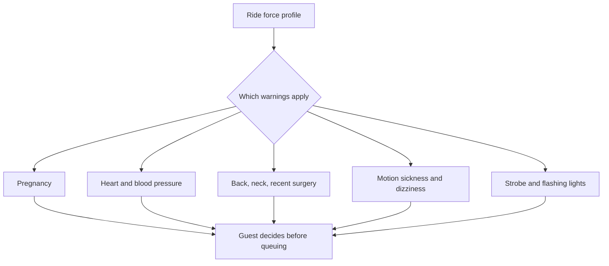

Every thrill ride entrance carries a list of conditions that should keep someone off it: pregnancy, heart conditions, high blood pressure, back or neck problems, recent surgery, motion sickness, and sensitivity to strobe lighting. Operators publish the same lists ride by ride; Universal Orlando's rider guide is a clear example. The warnings are not diagnoses; they state what the ride does to a body so a guest can judge for themselves.

The logic comes from the ride's forces. Sustained positive g and sudden onset, covered in [g-tolerance and duration](../ride-engineering/g-tolerance-and-duration.md), are the concern for heart and blood-pressure conditions. Jerk and lateral loads matter for backs and necks. Spinning and screen-based rides trigger [motion sickness](../human-factors/motion-sickness.md). Design standards such as ASTM F2291 treat rider-facing warnings as part of the containment and accommodation thinking, and the ride's [risk assessment](../safety-standards/risk-assessment.md) records why each warning is there.

Pregnancy is listed on almost everything with meaningful forces because the evidence is thin and the consequence serious. Heat adds to all of this: NIOSH names pregnancy and some medications as heat-stress risk factors, so exclusions and [thermal comfort](../human-factors/thermal-comfort.md) overlap in summer. Wording differs between parks; this card describes common practice, not a mandated text.

## Explore further
- `universal-orlando-rider-guide` — Universal Orlando Guide for Rider Safety and Accessibility (PDF)
- `astm-f2291-design-standard` — ASTM F2291 Standard Practice for Design of Amusement Rides and Devices
- `niosh-heat-stress` — NIOSH: About Heat Stress
