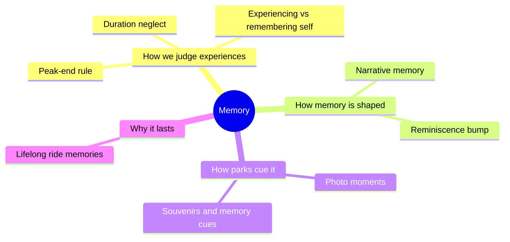

Daniel Kahneman's blunt line is that we do not choose between experiences, we choose between memories of experiences. A park day is twelve hours; the memory of it is a handful of snapshots, and those snapshots decide whether the family comes back. This super-concept gathers the research on how the snapshots get chosen.

Two findings do most of the work. The [peak-end rule](../human-factors/peak-end-rule.md) says the most intense moment and the ending dominate; [duration neglect](../human-factors/duration-neglect.md) says length barely counts. Together they explain why a long, hot queue fades while a ninety-second ride stays vivid. [Narrative memory](../human-factors/narrative-memory.md) adds that experiences with a story shape, a beginning, middle and end, are easier to keep and retell.

The rest of the group is about cues. [On-ride photos](../human-factors/photo-moments.md) and souvenirs are retrieval hooks that also make money. The [reminiscence bump](../human-factors/reminiscence-bump.md) explains why childhood visits echo for life. Designers reach for these ideas when shaping a [finale](../story-experience/finale-design.md) or the [pacing](../story-experience/pacing-and-structure.md) of a whole land.

## Explore further
- `kahneman-thinking-fast-and-slow` — Thinking, Fast and Slow
- `kahneman-ted-2010-experience-vs-memory` — The Riddle of Experience vs. Memory
