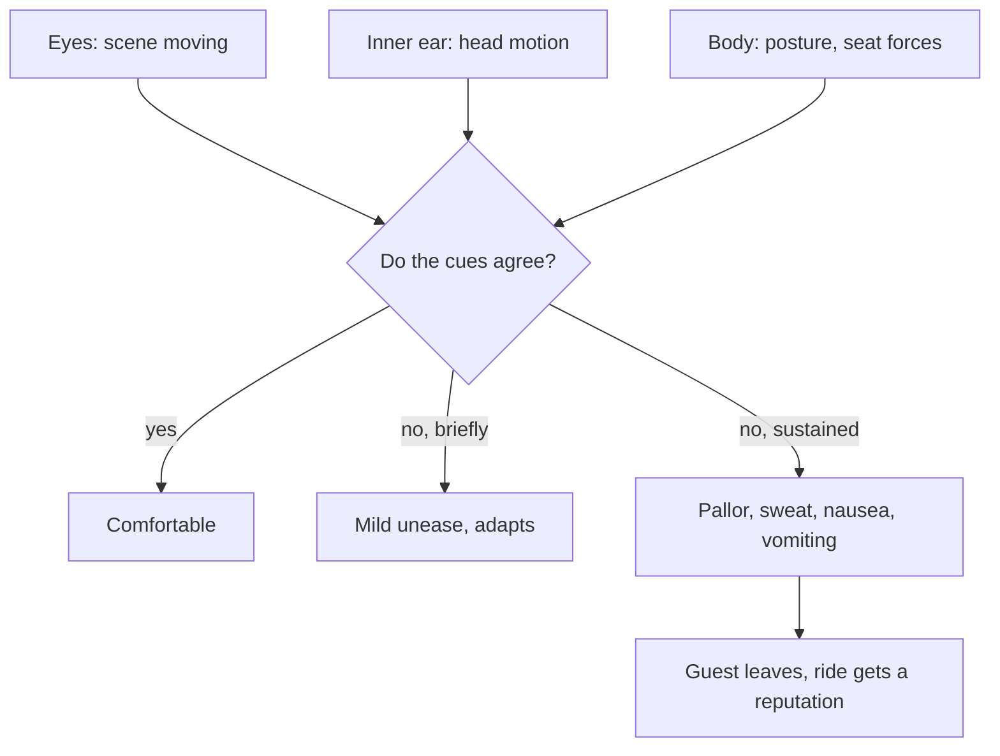

Motion sickness is the body's reaction to motion it cannot make sense of. James Lackner's review lists the familiar cascade, stomach awareness, pallor, cold sweat, then nausea, and notes that susceptibility varies enormously between people and falls with repeated exposure. Reading or looking at a screen inside a moving vehicle is the everyday trigger; a simulator theatre is the theme-park equivalent.

Two theories compete to explain it. [Sensory conflict theory](../human-factors/sensory-conflict-theory.md) blames a mismatch between what the eyes, inner ear and body report and what the brain expects. [Postural instability theory](../human-factors/postural-instability-theory.md) argues that sickness follows a prolonged failure to keep the body stable. Both agree on one thing: moving pictures without matching motion, the [vection](../human-factors/vection.md) that Hettinger and Riccio tied to visually induced sickness, is the main hazard in [media-based dark rides](../ride-systems/media-dark-ride.md), [simulator theatres](../ride-systems/motion-simulator-theatre.md) and [VR](../ai-future/vr-ar-in-parks.md).

Design levers are concrete: match [motion cueing](../ride-systems/motion-cueing.md) to the picture, cut latency, keep show length short, provide a stable visual frame, and state the risk in [health warnings](../human-factors/medical-exclusions.md).

## Explore further
- `lackner-2014-motion-sickness` — Motion Sickness: More Than Nausea and Vomiting
- `reason-brand-1975-motion-sickness` — Motion Sickness
- `hettinger-riccio-1992-vims` — Visually Induced Motion Sickness in Virtual Environments
