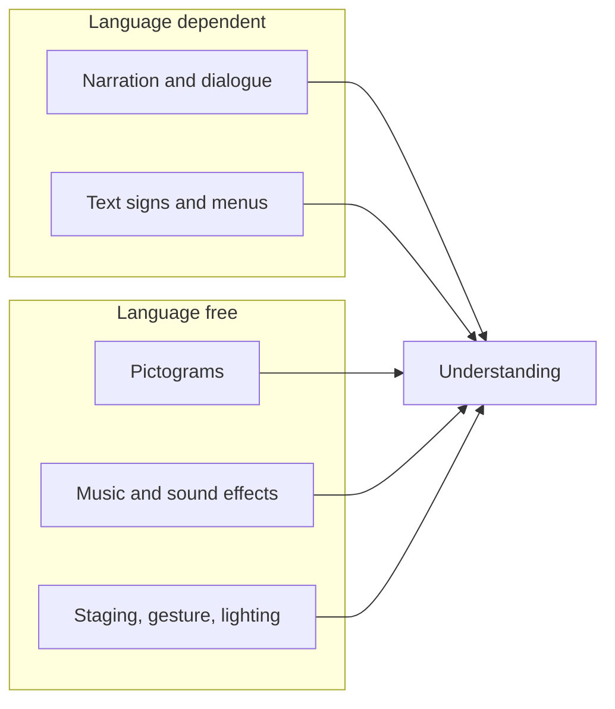

A destination park may host guests speaking dozens of languages on the same day. Disneyland Paris sits a train ride from several countries and runs shows and signage in French and English; Shanghai's park, as Cheung and McCarthy describe, cut American references that would need explaining. The design question is the same everywhere: how much of the experience depends on words?

The best answer is as little as possible. A dark ride whose story reads from staging, lighting, [music](../show-technology/onboard-and-spatial-audio.md) and character gesture needs no subtitles; one that depends on a joke in the narration will fall flat for half the audience. Safety information is the exception that must work for everyone, so ride rules use pictograms, demonstrations and physical design rather than text, which also helps [rider compliance](../human-factors/rider-compliance.md). Height signs, warning icons and arrows belong to the [signage](../design-process/signage-and-graphics.md) system and follow international pictogram conventions.

Where words are unavoidable, parks choose two or three dominant languages for [show scripts](../story-experience/show-scripts.md) and spiels, and performers in [cast role-play](../story-experience/cast-role-play.md) learn a few phrases in many. Translation changes meaning, so this overlaps with [localisation](../human-factors/localisation.md). Languages used at parks other than Paris and Shanghai were not verified here.

## Explore further
- `wikipedia-disneyland-paris` — Disneyland Paris
- `cheung-mccarthy-shanghai-disneyland-2019` — The emotional branding of Disneyland in Shanghai
