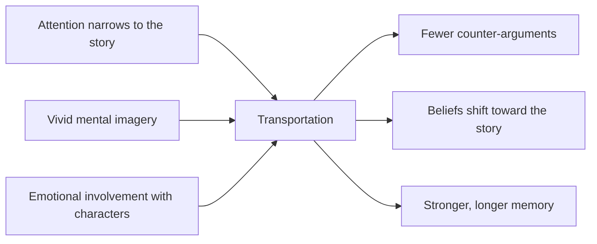

Melanie Green and Timothy Brock defined narrative transportation in 2000 as a convergent process where attention, imagery and feeling all focus on the events of a story. Their experiments showed that transported readers believed more of what the story implied, liked its characters more, and noticed fewer "false notes". Transportation was just as strong whether a story was labelled fact or fiction.

For a ride designer the mechanism is a target. A guest who is transported stops evaluating and starts experiencing, which is exactly what [story-driven design](../story-experience/story-driven-design.md) wants. The [queue](../story-experience/queue-storytelling.md) is where transportation begins, by narrowing attention and introducing characters before the vehicle appears. The [ride beat sheet](../story-experience/ride-beat-sheet.md) then keeps imagery and emotion rising together. Star Wars: [Rise of the Resistance](../history/rise-of-the-resistance.md) is the fullest attempt: one continuous story from queue to unload, with live performers.

Transportation also explains why ride stories stick. The [narrative memory](../human-factors/narrative-memory.md) card covers how a story structure makes an experience easier to recall and retell. Janet Murray's point about immersion and agency adds the caution: giving the guest too many choices can pull attention back to the choosing and out of the story.

## Explore further
- `green-brock-narrative-transportation-2000` — The role of transportation in the persuasiveness of public narratives
- `murray-hamlet-on-the-holodeck` — Hamlet on the Holodeck (book)
