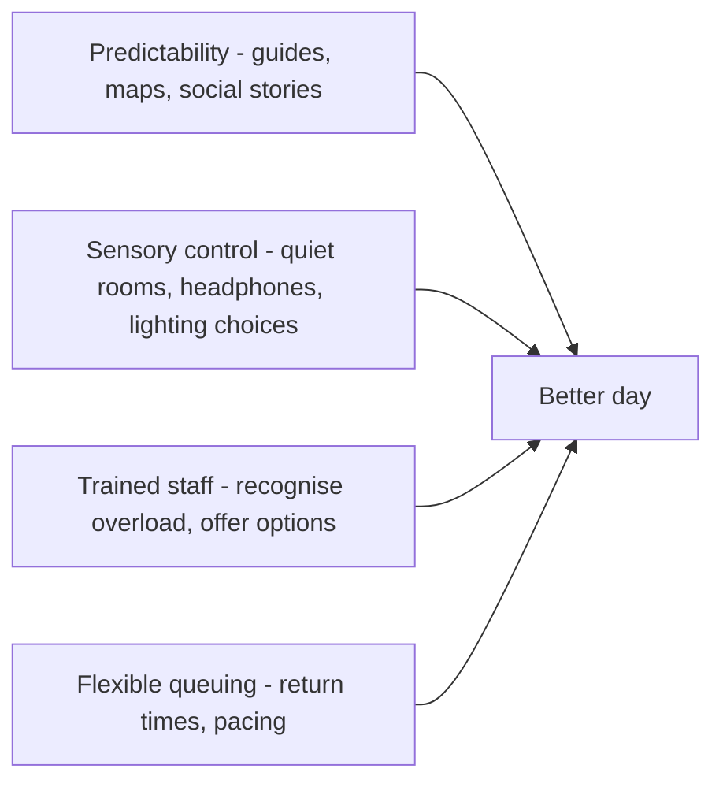

Neurodiversity is the plain fact that brains differ in how they process sound, light, touch, surprise and social demand. For many autistic guests, and for people with ADHD or PTSD, a theme park is both a dream and a hazard: it is intense by design. Sensory-friendly design makes the intensity predictable and optional.

The industry now has a recognised playbook. In 2018 Sesame Place in Pennsylvania became the first theme park certified as a Certified Autism Center by IBCCES, which requires at least 80 percent of guest-facing staff to complete autism training, an onsite review, and sensory guides for each activity. Sesame Place added quiet rooms and low-sensory parade viewing. KultureCity's Sensory Inclusive programme offers a parallel route with staff training, sensory bags and signage. Walt Disney World publishes planning resources for neurodivergent guests, including attraction-by-attraction sensory details.

For designers the levers are concrete. Rate each attraction on sound, light, smell, motion and surprise, and publish it, the subject of [sensory guides and quiet rooms](../human-factors/sensory-guides-and-quiet-rooms.md). Avoid unavoidable strobes in a [pre-show](../story-experience/pre-show.md). Use [audio zoning](../sensory-environment/audio-zoning.md) to leave real quiet somewhere. Train operators, through [operator training](../safety-standards/operator-training.md), to recognise overload and offer a way out rather than a rule.

## Explore further
- `ibcces-certified-autism-center` — Certified Autism Center program (IBCCES)
- `phillymag-sesame-place-autism-2018` — Sesame Place Makes History With Autism Designation
- `disney-neurodivergent-services` — Services for Guests who are Neurodivergent (Walt Disney World)
- `kulturecity-sensory-inclusive` — KultureCity Sensory Inclusive certification
