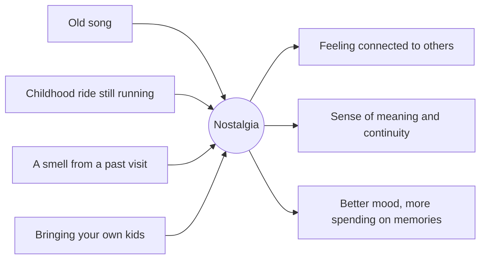

Constantine Sedikides and colleagues reviewed what nostalgia actually does and found it is mostly a positive, social emotion. People who are prompted to recall a treasured past moment feel more connected to others, more sure that life has meaning, and more willing to approach the future. It is bittersweet, but the sweet dominates.

Theme parks are nostalgia engines by design. A turn-of-the-century Main Street evokes a past no guest lived through; the original Disneyland of 1955 is now itself the past being evoked. Classic attractions that survive decades let adults ride the memory of being eight, often with their own children in the next seat. [Area music](../sensory-environment/area-music.md) is a cheap and potent trigger, and so is [scent](../human-factors/scent-and-memory.md).

Because the strongest triggers come from the [reminiscence bump](../human-factors/reminiscence-bump.md), roughly ages ten to thirty, parks face a real constraint: [retheming](../operations-business/retheming-and-overlays.md) or closing an old ride erases a trigger for a whole generation, and the [ride lifecycle](../operations-business/ride-lifecycle.md) has to weigh that loss.

## Explore further
- `sedikides-2008-nostalgia` — Nostalgia: Past, Present, and Future
- `munawar-2018-reminiscence-bump` — Understanding the Reminiscence Bump: A Systematic Review
