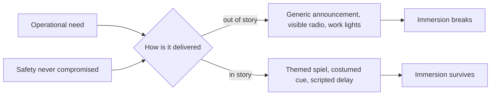

Operational intrusion is the break that comes from the people and procedures that run the ride: a bored spiel read from a card, a radio call over the loading music, a flashlight sweep during a dark scene, a stop announced as "we are experiencing technical difficulties". None is wrong on safety grounds; standards such as ASTM F770 rightly demand clear procedures. The failure is that the procedure was never designed for the story.

The best parks treat operations as part of the show. Cast members in [role](../story-experience/cast-role-play.md) deliver safety spiels in character, so a restraint check becomes a warning from the expedition. [Load areas](../story-experience/load-as-story.md) are staged as scenes, so the moment of boarding is a story beat. Even delays can be scripted: an in-world explanation for a brief hold does less damage than silence and a generic apology. Where the hold becomes an [evacuation](../safety-standards/emergency-stop-and-evacuation.md), the story has to stop, and the skill shifts to [guest recovery](../operations-business/guest-recovery.md).

The trade-off is training. Every in-story procedure must still be unambiguous under stress, which is why [operator training](../safety-standards/operator-training.md) rehearses both the themed version and the plain one. How much these breaks cost is not well measured; treat the effect as suggested, not quantified.

## Explore further
- `astm-f770-operation-maintenance` — ASTM F770-22 Standard Practice for Ownership, Operation, Maintenance, and Inspection
- `slater-place-illusion-plausibility-2009` — Place illusion and plausibility can lead to realistic behaviour in immersive virtual environments
