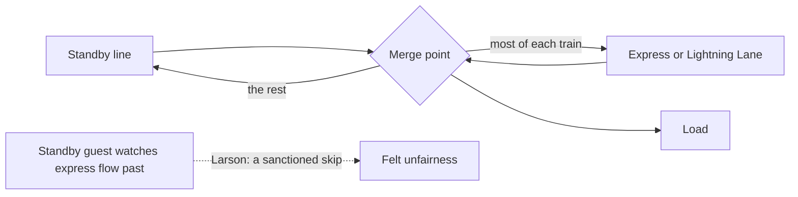

Universal's Express Pass and Disney's Lightning Lane sell the same thing: a second entrance whose guests are blended into each dispatch ahead of standby. When Genie+ launched at Walt Disney World on 19 October 2021 it cost 15 dollars per person per day, with the most popular rides sold separately at roughly 7 to 15 dollars each and limited to two a day. Prices and rules have shifted repeatedly since, and in 2024 the product was renamed Lightning Lane Multi Pass.

The economics are attractive: a line is a free good being sold, and the revenue is almost pure margin. The psychology is harder. Larson's fairness work predicts that a standby guest watching the express lane merge ahead of them experiences a *skip*, the most resented of queue violations, and that resentment is aimed at the park rather than at the express guests. Operators answer with [load design](../operations-business/load-unload-design.md) that hides the merge, [dispatch procedures](../safety-standards/dispatch-procedures.md) that fix the blend ratio, and [pricing](../operations-business/pricing.md) that caps how many can buy.

There is a social cost too. Families who cannot pay wait longer than they would have before the product existed, which is a question of [economic inclusion](../human-factors/economic-inclusion.md) as much as of [per-capita spending](../operations-business/per-capita-spending.md).

## Explore further
- `thepointsguy-genie-plus-launch-2021` — Disney has introduced a paid FastPass replacement: what Lightning Lanes cost
- `larson-1987-queue-social-justice` — Perspectives on Queues: Social Justice and the Psychology of Queueing
- `wikipedia-disney-virtual-queues` — Virtual queue systems at Disney Parks
