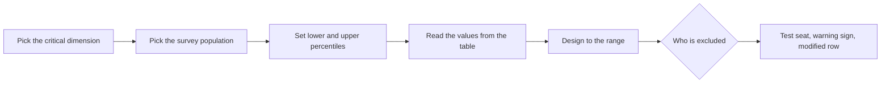

No seat fits everyone. Percentile design is the method for deciding the range: a designer picks a measurement, picks the population survey, and sets a lower and upper percentile that the design must accommodate. A common product-design convention is the 5th to the 95th percentile, which deliberately leaves out one person in ten at the extremes.

The method has traps. Percentiles do not add up: a person at the 95th percentile for stature is not at the 95th for hip breadth, so a "95th percentile person" does not exist. Designers therefore check each critical dimension separately, or use multivariate methods and digital human models. The population matters too: ANSUR II soldiers are not a sample of park guests, so safety-critical limits need a wider margin.

Rides raise the stakes because the people outside the range are not merely uncomfortable; they may not be safely restrained. [Patron accommodation](../safety-standards/patron-accommodation.md) requirements in ASTM F2291 push designers to state the rider range explicitly and to design [restraints](../safety-standards/restraint-design-rules.md) and [reach envelopes](../safety-standards/reach-envelope.md) against it. Where the range excludes people, test seats at the queue entrance, often built from the same [mockups](../design-process/mockups-and-prototypes.md) used in design, let guests find out before they wait.

## Explore further
- `ansur-ii-open-design-lab` — ANSUR II anthropometric dataset
- `astm-f2291-design-standard` — ASTM F2291 Standard Practice for Design of Amusement Rides and Devices
