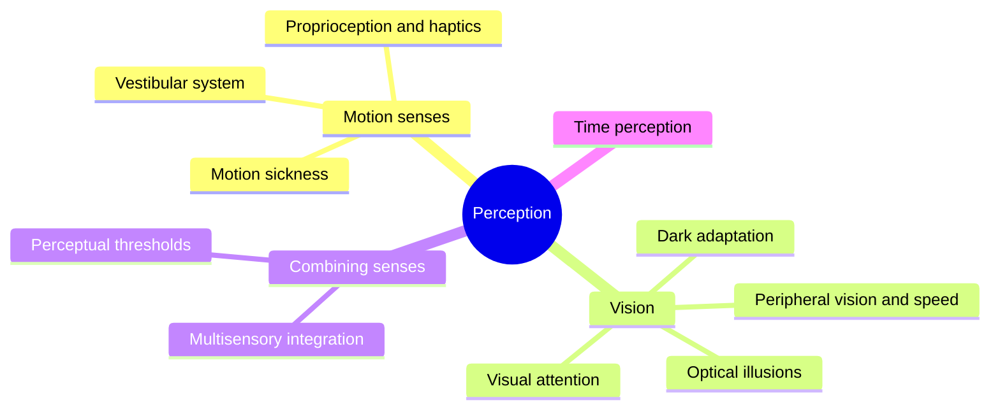

Nobody experiences a ride. They experience what their senses report about it, and the senses are both limited and easily fooled. That gap is the design space of this super-concept.

The motion side is anchored by the [vestibular system](../human-factors/vestibular-system.md), the inner ear's rotation and acceleration sensors, backed by the body's own [proprioception](../human-factors/proprioception-and-haptics.md). They set what a [motion base](../ride-systems/motion-cueing.md) can fake and, when they disagree with the eyes, produce [motion sickness](../human-factors/motion-sickness.md). The visual side explains why [forced perspective](../story-experience/forced-perspective.md) works, why speed feels greater in a tunnel, and why a dark ride needs a dim corridor to let the eyes adapt.

Two cross-cutting ideas tie it together. [Perceptual thresholds](../human-factors/perceptual-thresholds.md) say how small a change can be before nobody notices, which is where simulators hide their cheats. [Multisensory integration](../human-factors/multisensory-integration.md) says that well-timed sound, wind and light reinforce each other far beyond their sum, which is the physiological case for a tightly synchronised show.

## Explore further
- `wikipedia-vestibular-system` — Vestibular system
- `stein-stanford-2008-multisensory-integration` — Multisensory Integration: Current Issues from the Perspective of the Single Neuron
- `khan-imagineering-in-a-box` — Imagineering in a Box
