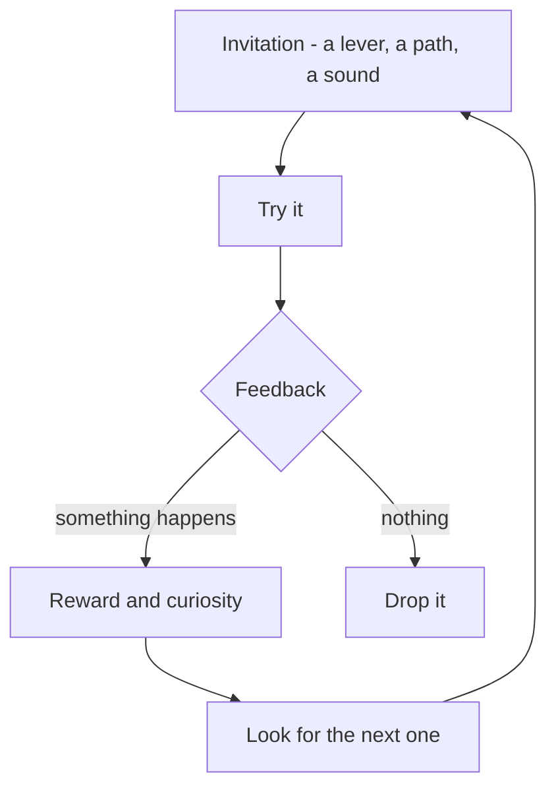

Play is behaviour done for its own sake, inside a boundary where ordinary rules pause. Johan Huizinga called that boundary the **magic circle**; a themed land is one of the largest magic circles ever built. Stuart Brown argues that adults need play as much as children, which is why grown guests touch the rockwork and pull every lever in a queue.

Exploration is play's quieter twin: the urge to see what is around the corner. Walt Disney World's older lands reward it with side paths, caves and overlooks that most guests never see on a map. Designers build an **invitation, feedback, reward** loop: something that looks touchable, a response when touched, and a reason to look for the next one. [Interactive queues](../human-factors/interactive-queues.md) and the interactive pre-shows at attractions such as Shanghai's Pirates ride use exactly this loop to make waiting feel like doing.

The craft overlaps with [environmental storytelling](../story-experience/environmental-storytelling.md), where props and wear patterns tell the story to whoever looks, and with [level design](../story-experience/level-design-parallels.md) in games, where designers plant "breadcrumbs" to pull players through space. Unexpected rewards for exploring are a cheap source of [surprise and delight](../human-factors/surprise-and-delight.md).

## Explore further
- `huizinga-homo-ludens` — Homo Ludens (book)
- `brown-play` — Play: How It Shapes the Brain (book)
