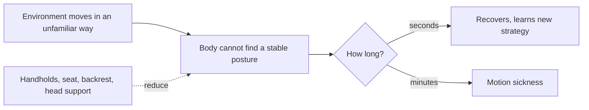

Gary Riccio and Thomas Stoffregen rejected the comparator in sensory conflict theory on a simple ground: the brain has no way to know in advance which combinations of signals are "wrong". Their 1991 alternative is ecological. Animals are constantly controlling posture, and sickness is what happens when the environment moves in a way that defeats that control for long enough. The theory predicts that measurable postural instability comes *before* symptoms, and several later experiments found exactly that.

For ride design the two theories pull in different directions. Conflict theory says to fix the picture; instability theory says to fix the body. The practical prescriptions from the second: a seat that locates the hips and back, [restraints](../human-factors/restraint-fit.md) that let the rider brace, head support on fast-onset rides, and good [vehicle suspension](../ride-engineering/vehicle-suspension.md) so the body is not fighting random jolts. A [rough ride](../ride-engineering/rough-rides.md) is sickening on this account because it never lets posture settle. Standing simulators and VR walking rigs are the riskiest case, which is why [seat and containment](../ride-engineering/seat-and-containment.md) choices matter for comfort as much as for safety.

Most researchers now treat the two theories as complementary rather than rivals.

## Explore further
- `riccio-stoffregen-1991-postural-instability` — An Ecological Theory of Motion Sickness and Postural Instability
