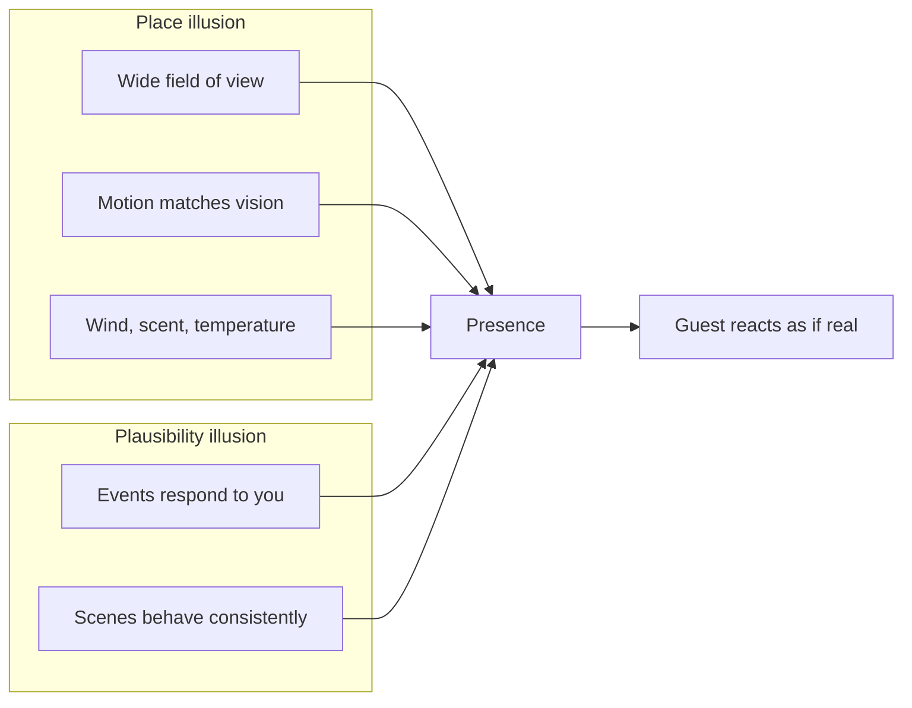

Presence is what makes a guest duck under a low branch that is only projected, or grip the lap bar on a flying theatre that is barely moving. Mel Slater's 2009 account splits it into two illusions. **Place illusion** is the feeling of being somewhere: it comes from the sensory system being fed a consistent world, especially when your own movement changes what you see. **Plausibility illusion** is the feeling that events are really happening: it comes from the world responding to you and behaving the way such a world should. 
Slater and Sanchez-Vives's 2016 review adds the crucial point: when both illusions hold, people behave as they would in the real situation. That is why guests scream and lean on rides whose physical motion is small.

Rides build place illusion with wide [domes and screens](../ride-systems/flying-theatre.md), [motion cueing](../ride-systems/motion-cueing.md) that matches the picture, and wind, mist and scent aimed at the rider, a [multisensory](../human-factors/multisensory-integration.md) stack that Pandora's [Flight of Passage](../history/flight-of-passage.md) is known for. Plausibility illusion is rarer and harder: it needs the scene to react, which is where [interactive](../story-experience/interactive-narrative.md) and [VR attractions](../ai-future/vr-ar-in-parks.md) have an edge over filmed media.

## Explore further
- `slater-place-illusion-plausibility-2009` — Place illusion and plausibility can lead to realistic behaviour in immersive virtual environments
- `slater-sanchez-vives-immersive-vr-2016` — Enhancing Our Lives with Immersive Virtual Reality
