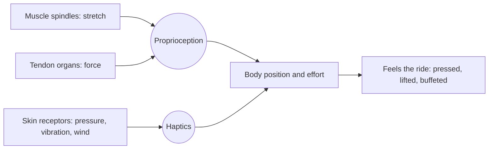

Proprioception is the sense of where your limbs are and how hard your muscles are working, built from stretch receptors in muscle, force receptors in tendons and receptors in the skin. Uwe Proske and Simon Gandevia's review stresses that it works mostly beneath awareness, yet it is how you know you are being pressed into a seat on a pull-up, or bracing against a lateral turn.

Haptics is the skin side: pressure, vibration, texture and air movement. Rides are richer here than they look. The lap bar pushing on the thighs tells the body "held", a precondition for the [protective frame](../human-factors/protective-frame.md), which makes [restraint fit](../human-factors/restraint-fit.md) a perceptual issue as well as a safety one. Wind on the face is the dominant speed cue in a dark tunnel. Seat rumble from a [vehicle suspension](../ride-engineering/vehicle-suspension.md), or deliberate shakers in a [4D theatre](../ride-systems/4d-theatres.md), convince the body that the picture is real.

Queue and set [tactile design](../sensory-environment/tactile-design.md) extends this to the hands, and the next generation of [haptic motion systems](../ai-future/haptics-and-next-gen-motion.md) aims to deliver localised touch cues on cue.

## Explore further
- `proske-gandevia-2012-proprioception` — The Proprioceptive Senses
