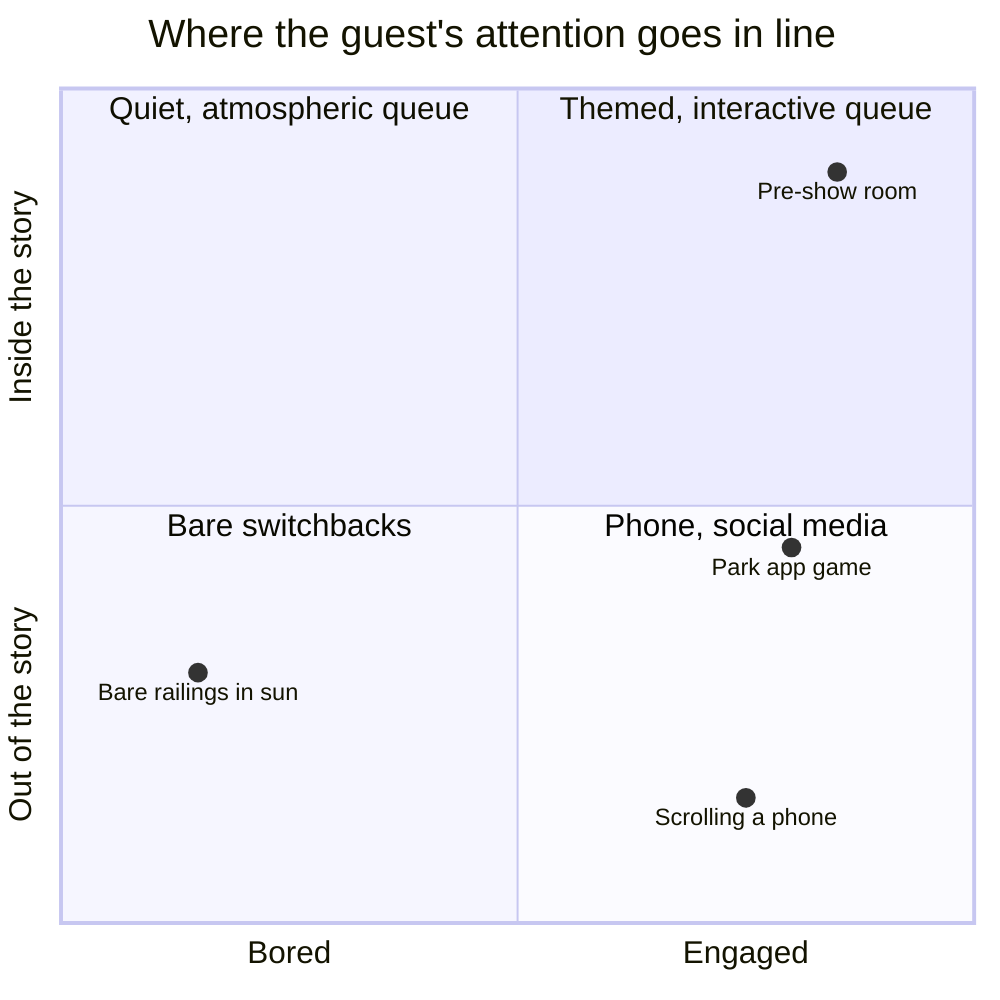

Boredom is the default state of a line, and Maister's propositions say it is corrosive: unoccupied time drags, and anxious, solitary waiting drags more. For most of park history the answer was theming. Today guests bring their own, and a queue of a hundred people is a hundred screens.

That is a mixed result. The phone is perfect [occupied time](../human-factors/occupied-time.md), so complaints about felt wait fall. But it also [breaks immersion](../human-factors/breaking-immersion.md): a guest scrolling through the pre-show has not been told the story the ride assumes they know. Parks have responded by competing for the screen rather than fighting it. Wait-time apps and mobile ordering turn the phone into an operations tool; queue-specific games and trivia tied to the ride attempt to keep the phone inside the fiction; and the Mental Floss account of Galaxy's Edge notes how heavily its queue invests in physical spectacle to win attention back.

How much phone use actually lowers felt wait compared with theming, and the size of the immersion cost, is uncertain; the design argument here rests on Maister's general propositions rather than on published queue-specific measurements. [Queue storytelling](../story-experience/queue-storytelling.md) and [personalisation](../ai-future/personalization.md) are the two live strategies.

## Explore further
- `maister-psychology-of-waiting-lines` — The Psychology of Waiting Lines
- `mentalfloss-disney-queue-psychology` — The Psychological Tricks Disney Parks Use to Make Long Wait Times More Bearable
