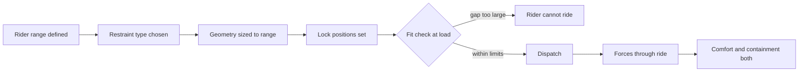

A restraint has two jobs that pull against each other. It must contain the rider through every force the ride produces, including the moment a child goes weightless over an [airtime hill](../ride-engineering/airtime-hills.md). It must also be comfortable: no bruised adults, no nervous rider feeling trapped. Restraint fit is making one device do both across the whole rider range.

Fit starts with the anthropometric range the ride is designed for. ASTM F2291's Section 5 on patron restraint and containment asks designers to match restraint type and geometry to the ride's forces and intended riders, with an appendix for riders under 48 inches. A lap bar that locks in many positions fits more bodies than one with two; a bar that contacts the thigh rather than the belly tolerates more shapes. Where a seatbelt backs up a bar, the belt length becomes part of the fit envelope.

Fit is then checked by people. [Dispatch procedures](../safety-standards/dispatch-procedures.md) include a visual or physical check of every restraint, and [locking systems](../ride-engineering/restraint-locking.md) report their state to the control system. [Head and neck loads](../ride-engineering/head-and-neck-loads.md) depend on how well the shoulders are held, which is why over-the-shoulder restraints on inverting rides are shaped around the collarbone.

## Explore further
- `astm-f2291-design-standard` — ASTM F2291 Standard Practice for Design of Amusement Rides and Devices
- `ansur-ii-open-design-lab` — ANSUR II anthropometric dataset
