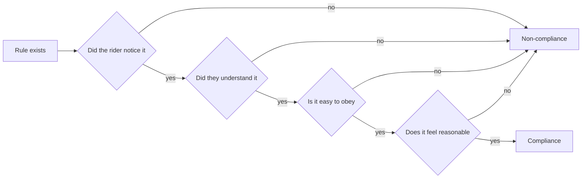

Rider compliance is the share of guests who actually keep hands inside, stay seated, stow loose items and respect height limits. Many ride injuries involve a rider doing something the ride was not designed for, so compliance is a safety topic, and it reaches operations standards such as ASTM F770 through operator training and procedures.

People break rules for predictable reasons. They did not see the sign in a crowded station, they did not understand it, obeying was awkward, or the rule seemed pointless. Each failure has a design answer. A spoken spiel reaches people who ignore signs. A pictogram crosses languages. A bin for loose articles at the load point makes stowing easy. A short, honest reason makes the rule feel sensible. Good [choice architecture](../human-factors/choice-architecture.md) makes the compliant option the default rather than a request.

The deepest fix is engineering out the chance to fail. [Reach envelopes](../safety-standards/reach-envelope.md) place anything a rider could grab out of range. [Restraint design rules](../safety-standards/restraint-design-rules.md) assume the rider will try to wriggle. Operators are trained to check, not just ask, before [dispatch](../safety-standards/dispatch-procedures.md). The [human-factors incidents](../safety-standards/human-factors-incidents.md) record shows what happens when any of those layers is skipped.

## Explore further
- `astm-f770-operation-maintenance` — ASTM F770-22 Standard Practice for Ownership, Operation, Maintenance, and Inspection
- `iaapa-safety-and-security` — IAAPA Safety & Security resources
- `thaler-sunstein-nudge` — Nudge (book)
