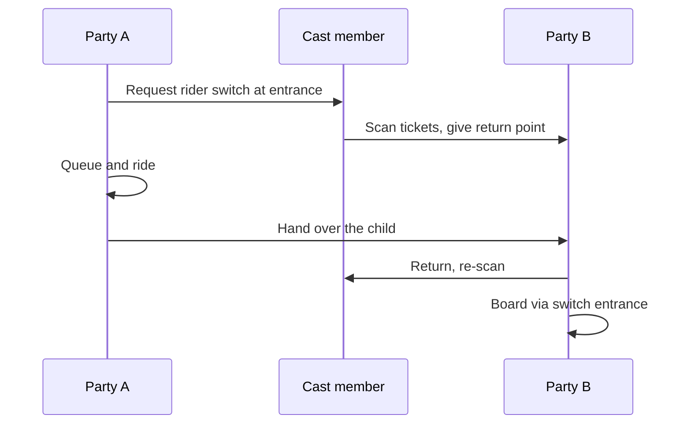

Rider switch (also called child swap) fixes a common family problem: two adults, one child too short for a ride, and nobody wants to queue twice. The group asks at the entrance. One party queues and rides while the other waits with the child; then the second party enters through a short return path and rides without the full wait.

Walt Disney World's version splits the group into Party A and Party B, scans Party B's tickets, and lets up to two Party B guests ride on return. Universal Orlando documents a similar scheme in its rider guide and builds child-swap rooms at the load area of major rides.

Designers have to make room for it. The [load and unload area](../operations-business/load-unload-design.md) needs a waiting space, a return path that bypasses the queue, and a merge point that does not disrupt the [dispatch rhythm](../safety-standards/dispatch-procedures.md). Rider switch also protects [queue fairness](../human-factors/queue-fairness.md): without it, families either skip the ride or cheat, and both make other guests angry. Cast members need clear [training](../safety-standards/operator-training.md) because the procedure changes from park to park.

## Explore further
- `disney-rider-switch` — What Is Rider Switch and How Does It Work?
- `universal-orlando-rider-guide` — Universal Orlando Guide for Rider Safety and Accessibility (PDF)
