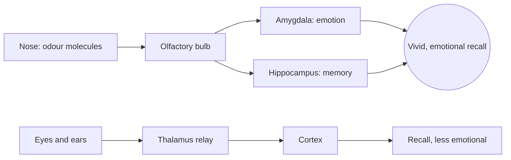

Rachel Herz asked people to recall personal memories cued by an item presented as a smell, as a picture or as a sound. Smell-cued memories were not more detailed, but they were rated more emotional and gave a stronger feeling of being carried back to the moment. The usual explanation is anatomical: smell signals reach the amygdala and hippocampus, the brain's emotion and memory hubs, with fewer stops than sight or sound.

Parks have used this for decades, and the hardware has a name: the [Smellitzer](../sensory-environment/smellitzers.md), a fan-driven scent cannon. Soarin' sends orange-grove and pine scent through the theatre at the matching scenes; Pirates of the Caribbean's damp, musty water smell is part of why the ride is remembered in the body rather than as a picture. [Scent storytelling](../sensory-environment/scent-storytelling.md) treats these as plot points, and a bakery vented onto a street is [retail placement](../masterplanning/food-and-retail-placement.md) through the nose.

The payoff is deferred. Years later, a similar smell anywhere else can bring the whole day back, which makes scent one of the cheapest routes to [nostalgia](../human-factors/nostalgia.md) and a reason to keep [scent design](../sensory-environment/scent-design.md) consistent across a ride's life.

## Explore further
- `herz-2004-scent-memory` — A Naturalistic Analysis of Autobiographical Memories Triggered by Olfactory, Visual and Auditory Stimuli
