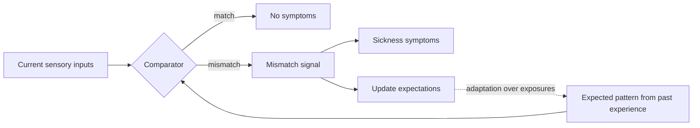

James Reason and Joseph Brand's 1975 monograph set out the idea that has dominated the field since. The brain holds an expectation, built from a lifetime of movement, of how visual, vestibular and bodily signals should line up. Motion sickness is what happens when the incoming pattern does not match that expectation, either because two senses contradict each other (eyes say moving, inner ear says still) or because the canals and otoliths disagree with each other (a rotation that the gravity sensors say is impossible). The mismatch signal fades as the expectation updates, which is why people adapt.

The theory is a practical checklist for a simulator or screen ride. In a [dome theatre](../show-technology/domes-and-wraparound-screens.md), a swooping camera with a static seat is a pure visual–vestibular conflict; [motion cueing](../ride-systems/motion-cueing.md) exists to reduce it. [Stereoscopic 3D](../show-technology/stereoscopic-3d.md) adds a depth-cue conflict of its own. Tight [ride–show synchronisation](../show-technology/ride-show-synchronization.md) keeps the senses in step.

Critics, led by Riccio and Stoffregen, point out that the theory cannot say in advance how much conflict is too much, which is the opening for [postural instability theory](../human-factors/postural-instability-theory.md).

## Explore further
- `reason-brand-1975-motion-sickness` — Motion Sickness
- `lackner-2014-motion-sickness` — Motion Sickness: More Than Nausea and Vomiting
