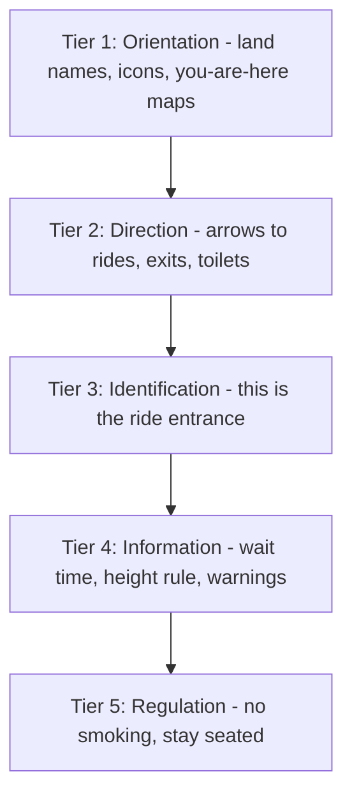

A signage hierarchy sorts every sign by the question it answers, then sizes and places it to match. Big questions get big, early answers: which land is this, which way to the exit. Small questions get small, late answers: how tall must my child be, where do I store my bag. Wayfinding designers often describe five tiers: orientation, direction, identification, information and regulation.

The order matters because [visual attention](../human-factors/visual-attention.md) is scarce and sequential. A guest at a junction scans for a single confident arrow, not a paragraph. If a rule sign and a direction sign compete at the same height and weight, both lose. Retail researchers such as Paco Underhill found that people simply do not read signs placed in the first few steps past a threshold, which is why theme park entry gates keep the first signs few and far.

Themed parks add a twist: the sign must also stay in [character](../design-process/signage-and-graphics.md), using period lettering and materials so it never becomes [visual intrusion](../human-factors/visual-intrusion.md). The five-tier framing here is a common professional convention rather than a published standard, so treat the exact labels as a guide, not a rule.

## Explore further
- `lynch-image-of-the-city` — The Image of the City (book)
- `underhill-why-we-buy` — Why We Buy: The Science of Shopping (book)
