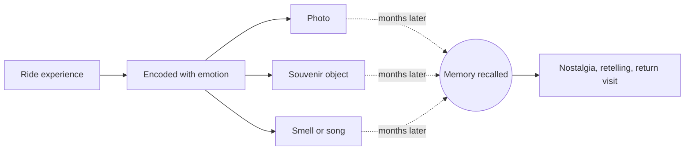

A memory is only useful if something can bring it back. Psychologists call those somethings retrieval cues, and the tourism trade calls them souvenirs. Hugh Wilkins's survey work found people buy souvenirs for three main reasons: as evidence they were there, as gifts that share the trip, and as objects to remember by. The last one is the one a designer can engineer.

The strongest cues are the ones encoded alongside the experience. A photo taken at the peak, a pin bought at the exit while the heart is still racing, a bag of the churros smelled in the queue. Rachel Herz found that memories triggered by [smell](../human-factors/scent-and-memory.md) feel more emotional than those triggered by pictures or sounds, which gives [scent design](../sensory-environment/scent-design.md) a retail afterlife.

The classic layout, [exit through the gift shop](../masterplanning/food-and-retail-placement.md), puts the cue purchase at the moment of highest arousal, right after [unload](../operations-business/load-unload-design.md). It is a large contributor to [per-capita spending](../operations-business/per-capita-spending.md), and years later each cue feeds [nostalgia](../human-factors/nostalgia.md) and the urge to come back.

## Explore further
- `wilkins-2011-souvenirs` — Souvenirs: What and Why We Buy
- `herz-2004-scent-memory` — A Naturalistic Analysis of Autobiographical Memories Triggered by Olfactory, Visual and Auditory Stimuli
