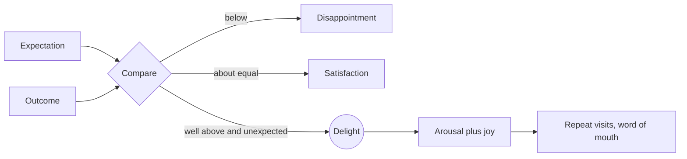

Richard Oliver and colleagues separated delight from mere satisfaction. Satisfaction is getting what you expected. Delight is a positive surprise large enough to raise arousal, and in their studies, one of them run in a theme park, it predicted loyalty more strongly than satisfaction did. The practical reading: meeting expectations keeps guests; exceeding them unexpectedly makes fans.

Rides manufacture surprise with structure. Expedition Everest at Disney's Animal Kingdom sends its train up to broken track, then rolls it backwards into darkness, a reversal most first-time riders do not predict. Dark rides hide a gag behind a turn using [misdirection](../show-technology/misdirection.md). Small, unadvertised details, the hidden sculptures and in-jokes that come from [plussing](../story-experience/plussing.md), reward guests who look closely.

Surprise is spent quickly. Once the trick is known, delight fades toward satisfaction, which is why parks keep adding and why [service culture](../operations-business/service-culture.md) matters: a cast member's unexpected kindness cannot be spoiled online. Delight also tends to become the remembered [peak](../human-factors/peak-end-rule.md) of a day.

## Explore further
- `oliver-1997-customer-delight` — Customer Delight: Foundations, Findings, and Managerial Insight
